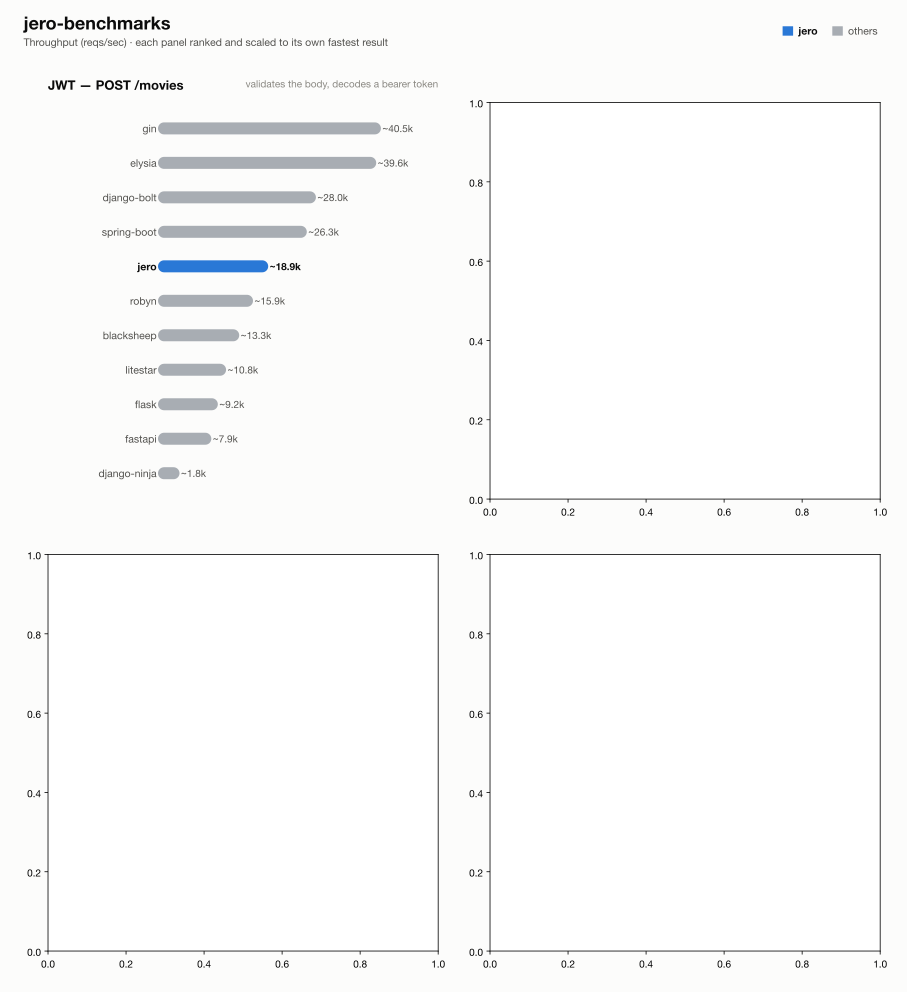

# jero-benchmarks — run `20260914T103520`

_Generated 2026-09-14T11:17:38+00:00_

## Run configuration

| | |
| --- | --- |
| **Run ID** | `20260914T103520` |
| **Created** | 2026-09-14 10:36:26 UTC |
| **Host** | ip-172-31-28-24.eu-central-1.compute.internal |
| **AWS region** | eu-central-1 |
| **EC2 instance type** | c9g.2xlarge |
| **EC2 AMI** | `ami-0f7d895aa37851cb2` |
| **k6 VUs** | 128 |
| **Duration per attempt** | 60s |
| **Best of** | 3 |
| **Server workers** | 1 |
| **Python server** | granian |
| **Event loop** | uvloop |
| **Frameworks** | blacksheep, django-bolt, django-ninja, elysia, fastapi, flask, gin, jero, litestar, robyn, spring-boot |
| **Results backend** | mr-blobby |

## Results

### 2 - POST /movies (JWT)

| Framework | req/s | vs | mean | vs | p99 | vs | succ% | memPk | memAv | cpuAv | cpuPk | cpu ~ | mem ~ |
| --- | --- | --- | --- | --- | --- | --- | --- | --- | --- | --- | --- | --- | --- |
| gin | ~40.5k | x2.15 | 2.92ms | x2.30 | 13.21ms | x1.36 | 100.00 | 13M | 12M | 78% | 88% | ▆▆▆▇▇▇▇▇▇▇▇▇▇▇█▄ | ▇▇█▇▇▇▇▇▇▇▇▇▇▇▇▇ |
| elysia | ~39.6k | x2.10 | 3.09ms | x2.18 | 13.37ms | x1.35 | 100.00 | 37M | 30M | 83% | 94% | ▆▆▆▇▇▇▇▇▇▇▇▇▇▇█▄ | ▇█▇▆▆▆▆▆▆▆▆▆▆▆▆▆ |
| django-bolt | ~28.0k | x1.49 | 4.47ms | x1.51 | 14.99ms | x1.20 | 100.00 | 84M | 82M | 94% | 100% | ▆▇▇▇▇▇▇▇▇▇▇█▇▇▇▄ | ▇▇▇▇▇▇▇▇█▇▇▇▇▇▇▇ |
| spring-boot | ~26.3k | x1.39 | 4.75ms | x1.42 | 16.18ms | x1.11 | 100.00 | 608M | 606M | 93% | 100% | ▇▇▇▇▇▇▇▇▇▇▇▇▇▇█▄ | ▇▇▇█▇▇▇▇▇▇▇▇▇▇▇▇ |
| jero | ~18.9k | x1.00 | 6.73ms | x1.00 | 18.02ms | x1.00 | 100.00 | 80M | 79M | 100% | 102% | ▇▇▇█▇▇▇▇▇▇▇▇▇▇▇▇ | ▇█▇▇▇▇▇▇▇▇▇▇▇▇▇▇ |
| robyn | ~15.9k | x0.85 | 7.98ms | x0.84 | 18.37ms | x0.98 | 100.00 | 59M | 50M | 98% | 102% | ▇▇▇▇▇█▇▇▇▇▇▇▇▇▇▄ | █▆▆▆▆▆▆▆▇▆▆▆▆▆▆▆ |
| blacksheep | ~13.3k | x0.70 | 9.57ms | x0.70 | 20.43ms | x0.88 | 100.00 | 81M | 72M | 96% | 102% | ▆▇▇▇▇▇▇▇▇█▇▇▇▇▇▄ | ▇▇▇▇▇▇▇▇▇█▇▇▇▇▇▇ |
| litestar | ~10.8k | x0.57 | 11.83ms | x0.57 | 24.18ms | x0.75 | 100.00 | 86M | 78M | 101% | 102% | ▇▇▇▇▇▇▇▇▇▇▇▇▇▇▇█ | ▇▇▇█▇▇▇▇▇▇▇▇▇▇▇▇ |
| flask | ~9.2k | x0.49 | 13.87ms | x0.48 | 24.35ms | x0.74 | 100.00 | 88M | 78M | 102% | 103% | █▇▇▇▇▇▇▇▇▇▇▇▇▇▇▇ | ▇▇▇▇▇▇▇█▇▇▇▇▇▇▇▇ |
| fastapi | ~7.9k | x0.42 | 16.07ms | x0.42 | 31.11ms | x0.58 | 100.00 | 85M | 76M | 100% | 102% | ▇▇▇▇▇▇▇▇▇▇▇█▇▇▇▇ | ▇▇▇█▇▇▇▇▇▇▇▇▇▇▇▇ |
| django-ninja | ~1.8k | x0.10 | 69.95ms | x0.10 | 110.47ms | x0.16 | 100.00 | 119M | 110M | 95% | 100% | ▆▇▇▇▇▇▇▇▇▇▇▇▇▇█▄ | █▇▇▇▇▇▇▇▇▇▇▇▇▇▇▇ |

## How these results were made

**Isolation.** Exactly one framework container is ever alive at a time, alongside
the shared Postgres/upstream/k6-runner infra -- brought up via `compose.base.yml`
plus that framework's own `compose.<fw>.yml`, torn down before the next framework
starts. No two frameworks ever share a core or contend for host resources.

**One worker, one core.** Every service runs exactly 1 worker (granian
`--workers 1`, Gin `GOMAXPROCS=1`, Bun's single JS thread, Bolt `--processes 1`),
pinned to one dedicated CPU core via `cpuset` affinity -- not a CFS quota, which
throttles a saturated container every 100ms scheduler period and adds
tail-latency stalls; affinity confines all of a framework's threads (including
GIL-releasing extensions like `msgspec`/`psqlpy`) to one core with no such stalls.

**Equal resource budgets.** DB pool and outbound-HTTP pool are capped at **64**
connections for every framework/language.

**Best of N.** Each (framework, test) pair runs multiple attempts; the
attempt with the highest req/s is kept.

**Resource-use columns.** `memPk`/`memAv` = peak/average resident memory (MB);
`cpuAv`/`cpuPk` = average/peak CPU as % of one core (pinned via `cpuset`, so
these sit ≤100%); `cpu ~`/`mem ~` = a 0-to-max-scaled sparkline of the CPU/memory
time series during the attempt. Only the framework's own container is measured
-- Postgres and the upstream are excluded.

**Equal work, per test** -- every framework does the same task; only the
*native* tool differs:

| Framework | Language | Server | HTTP client | DB driver | Validates body (test 2) | Parses upstream (test 3) | JSON serializer |
| --- | --- | --- | --- | --- | --- | --- | --- |
| blacksheep | Python 3.13 | granian ASGI | pyreqwest | psqlpy | dataclass bind | passthrough dict | orjson |
| django-bolt | Python 3.13 | built-in Rust server | pyreqwest | psqlpy | msgspec Struct | passthrough bytes | msgspec |
| django-ninja | Python 3.13 | granian ASGI | pyreqwest | psqlpy | pydantic (Schema) | passthrough bytes | pydantic |
| elysia | Bun / TS | Bun native | fetch | Bun SQL | typebox schema | passthrough object | Bun native |
| fastapi | Python 3.13 | granian ASGI | pyreqwest | psqlpy | pydantic | typed (pydantic) + response-model re-validate | pydantic |
| flask | Python 3.13 | granian WSGI | pyreqwest (sync) | psycopg | pydantic | typed (pydantic) | stdlib json |
| gin | Go | net/http (GOMAXPROCS=1) | net/http | pgx | ShouldBindJSON struct | typed struct | encoding/json |
| jero | Python 3.13 | granian ASGI | pyreqwest | psqlpy | msgspec Struct | typed (msgspec) | msgspec |
| litestar | Python 3.13 | granian ASGI | pyreqwest | psqlpy | msgspec Struct | typed (msgspec) | msgspec |
| robyn | Python 3.13 | built-in Rust server | pyreqwest | psqlpy | pydantic (native param) | typed (pydantic) | stdlib json / pydantic |
| spring-boot | Java 25 | embedded Tomcat, virtual threads | RestClient (Apache HttpClient5) | JdbcTemplate (HikariCP) | jakarta bean validation (record) | typed (Jackson) | Jackson |

**One deliberate exception to per-framework idiom:** the two Django frameworks
reach Postgres through raw psqlpy -- the same driver the rest of the async
Python fleet uses -- rather than Django's ORM, whose sync-driver-behind-an-async-facade
design would make test 4 a measurement of Django's data layer instead of the
framework. For the same reason, every JWT endpoint hand-decodes the bearer
token with PyJWT rather than using each framework's own auth integration.

**Known, intended differences** (each framework's real idiomatic behaviour, kept
rather than normalised away): the JSON serializer column (stdlib `json` is
slower than msgspec/orjson/native); FastAPI additionally re-validates the
*response* against its `response_model`; Blacksheep/Elysia/Django Ninja/Django
Bolt return the upstream payload straight through as bytes/dict; the two Django
frameworks return snake_case field names where the rest of the Python fleet
returns camelCase; Spring Boot's Jackson binding coerces a numeric field given
as a JSON string rather than rejecting it like pydantic/msgspec do. These are
visible here so a number is never mistaken for pure framework speed.

## Disclosure

The author of this benchmark suite is also the author of [jero](https://pypi.org/project/jero/), one of the frameworks benchmarked here. Every measure above -- equal resource budgets, idiomatic code per framework, isolated single-framework runs, documented intended differences -- applies identically to jero and everyone else; nothing here is tuned in its favor.

---
_Generated by `export_results.py` from `results.is_best` rows in mr-blobby._