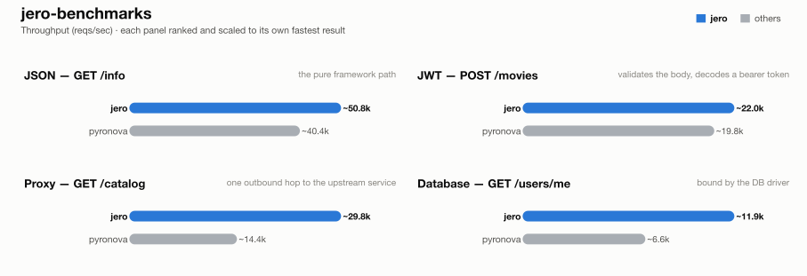

# jero-benchmarks — run `20260923T091554`

_Generated 2026-09-23T09:22:05+00:00_

## Run configuration

| | |
| --- | --- |
| **Run ID** | `20260923T091554` |
| **Created** | 2026-09-23 09:15:54 UTC |
| **Host** | NITRO-GY7N7RYTHK |
| **AWS region** | -- (not run on EC2) |
| **EC2 instance type** | -- |
| **EC2 AMI** | -- |
| **k6 VUs** | 100 |
| **Duration per attempt** | 10s |
| **Best of** | 3 |
| **Server workers** | 1 |
| **Python server** | granian |
| **Event loop** | uvloop |
| **Frameworks** | jero, pyronova |
| **Results backend** | TaglyDB |

## Results

### 1 - GET /info

| Framework | req/s | vs | mean | vs | p99 | vs | succ% | memPk | memAv | cpuAv | cpuPk | cpu ~ | mem ~ |
| --- | --- | --- | --- | --- | --- | --- | --- | --- | --- | --- | --- | --- | --- |
| jero | ~50.8k | x1.00 | 1.91ms | x1.00 | 9.13ms | x1.00 | 100.00 | 81M | 81M | 90% | 93% | ▇▇▇▇▇▇▇▇▇▇▇▇▇███ | ▇▇▇▇▇▇▇▇▇▇███▇▇▇ |
| pyronova | ~40.4k | x0.80 | 2.41ms | x0.79 | 10.70ms | x0.85 | 100.00 | 98M | 98M | 74% | 89% | ▇▇▇▇▇▇▇▇▇▇▇███▁▁ | ▇▇▇███▇▇▇▇▇▇▇▇▇▇ |

### 2 - POST /movies (JWT)

| Framework | req/s | vs | mean | vs | p99 | vs | succ% | memPk | memAv | cpuAv | cpuPk | cpu ~ | mem ~ |
| --- | --- | --- | --- | --- | --- | --- | --- | --- | --- | --- | --- | --- | --- |
| jero | ~22.0k | x1.00 | 4.51ms | x1.00 | 12.23ms | x1.00 | 100.00 | 82M | 82M | 100% | 100% | ▇▇▇▇▇▇▇▇▇▇███▇▇▇ | ▇▇▇▇███▇▇▇▇▇▇▇▇▇ |
| pyronova | ~19.8k | x0.90 | 5.02ms | x0.90 | 13.32ms | x0.92 | 100.00 | 139M | 139M | 85% | 101% | ███▇▇▇▇▇▇▇▇▇▇▇▁▁ | ▇▇▇▇▇▇▇▇▇▇▇███▇▇ |

### 3 - GET proxy (upstream)

| Framework | req/s | vs | mean | vs | p99 | vs | succ% | memPk | memAv | cpuAv | cpuPk | cpu ~ | mem ~ |
| --- | --- | --- | --- | --- | --- | --- | --- | --- | --- | --- | --- | --- | --- |
| jero | ~29.8k | x1.00 | 3.32ms | x1.00 | 10.49ms | x1.00 | 100.00 | 96M | 95M | 83% | 99% | ▇▇▇▇▇▇▇▇██████▁▁ | ▇▇▇▇▇▇▇▇▇▇▇███▇▇ |
| pyronova | ~14.4k | x0.48 | 6.93ms | x0.48 | 15.90ms | x0.66 | 100.00 | 248M | 243M | 85% | 102% | ▇▇▇▇▇▇▇▇███▇▇▇▁▁ | ▇▇▇▇▇▇▇▇▇▇▇███▇▇ |

### 4 - GET /users/me (DB)

| Framework | req/s | vs | mean | vs | p99 | vs | succ% | memPk | memAv | cpuAv | cpuPk | cpu ~ | mem ~ |
| --- | --- | --- | --- | --- | --- | --- | --- | --- | --- | --- | --- | --- | --- |
| jero | ~11.9k | x1.00 | 8.39ms | x1.00 | 16.60ms | x1.00 | 100.00 | 98M | 97M | 99% | 99% | ▇▇▇▇▇▇▇▇▇▇▇▇▇███ | ▇▇▇▇▇▇▇▇▇▇▇▇▇███ |
| pyronova | ~6.6k | x0.56 | 15.09ms | x0.56 | 29.50ms | x0.56 | 100.00 | 367M | 366M | 98% | 98% | ▇▇▇▇███▇▇▇▇▇▇▇▇▇ | ▇▇▇▇▇▇▇▇▇▇▇▇▇███ |

## How these results were made

**Isolation.** Exactly one framework container is ever alive at a time, alongside
the shared Postgres/upstream/k6-runner infra -- brought up via `compose.base.yml`
plus that framework's own `compose.<fw>.yml`, torn down before the next framework
starts. No two frameworks ever share a core or contend for host resources.

**One worker, one core.** Every service runs exactly 1 worker (granian
`--workers 1`, Gin `GOMAXPROCS=1`, Bun's single JS thread, Bolt `--processes 1`),
pinned to one dedicated CPU core via `cpuset` affinity -- not a CFS quota, which
throttles a saturated container every 100ms scheduler period and adds
tail-latency stalls; affinity confines all of a framework's threads (including
GIL-releasing extensions like `msgspec`/`psqlpy`) to one core with no such stalls.

**Equal resource budgets.** DB pool and outbound-HTTP pool are capped at **64**
connections for every framework/language.

**Best of N.** Each (framework, test) pair runs multiple attempts; the
attempt with the highest req/s is kept.

**Resource-use columns.** `memPk`/`memAv` = peak/average resident memory (MB);
`cpuAv`/`cpuPk` = average/peak CPU as % of one core (pinned via `cpuset`, so
these sit ≤100%); `cpu ~`/`mem ~` = a 0-to-max-scaled sparkline of the CPU/memory
time series during the attempt. Only the framework's own container is measured
-- Postgres and the upstream are excluded.

**Equal work, per test** -- every framework does the same task; only the
*native* tool differs:

| Framework | Language | Server | HTTP client | DB driver | Validates body (test 2) | Parses upstream (test 3) | JSON serializer |
| --- | --- | --- | --- | --- | --- | --- | --- |
| jero | Python 3.13 | granian ASGI | pyreqwest | psqlpy | msgspec Struct | typed (msgspec) | msgspec |
| pyronova | Python 3.13 | built-in Rust server (gil mode) | pyreqwest | psqlpy | pydantic (native model=) | typed (pydantic) | stdlib json / pydantic |

**One deliberate exception to per-framework idiom:** the two Django frameworks
reach Postgres through raw psqlpy -- the same driver the rest of the async
Python fleet uses -- rather than Django's ORM, whose sync-driver-behind-an-async-facade
design would make test 4 a measurement of Django's data layer instead of the
framework. For the same reason, every JWT endpoint hand-decodes the bearer
token with PyJWT rather than using each framework's own auth integration.

**Known, intended differences** (each framework's real idiomatic behaviour, kept
rather than normalised away): the JSON serializer column (stdlib `json` is
slower than msgspec/orjson/native); FastAPI additionally re-validates the
*response* against its `response_model`; Blacksheep/Elysia/Django Ninja/Django
Bolt return the upstream payload straight through as bytes/dict; the two Django
frameworks return snake_case field names where the rest of the Python fleet
returns camelCase; Spring Boot's Jackson binding coerces a numeric field given
as a JSON string rather than rejecting it like pydantic/msgspec do. These are
visible here so a number is never mistaken for pure framework speed.

## Disclosure

The author of this benchmark suite is also the author of [jero](https://pypi.org/project/jero/), one of the frameworks benchmarked here. Every measure above -- equal resource budgets, idiomatic code per framework, isolated single-framework runs, documented intended differences -- applies identically to jero and everyone else; nothing here is tuned in its favor.

---
_Generated by `export_results.py` from `results.is_best` rows in TaglyDB._