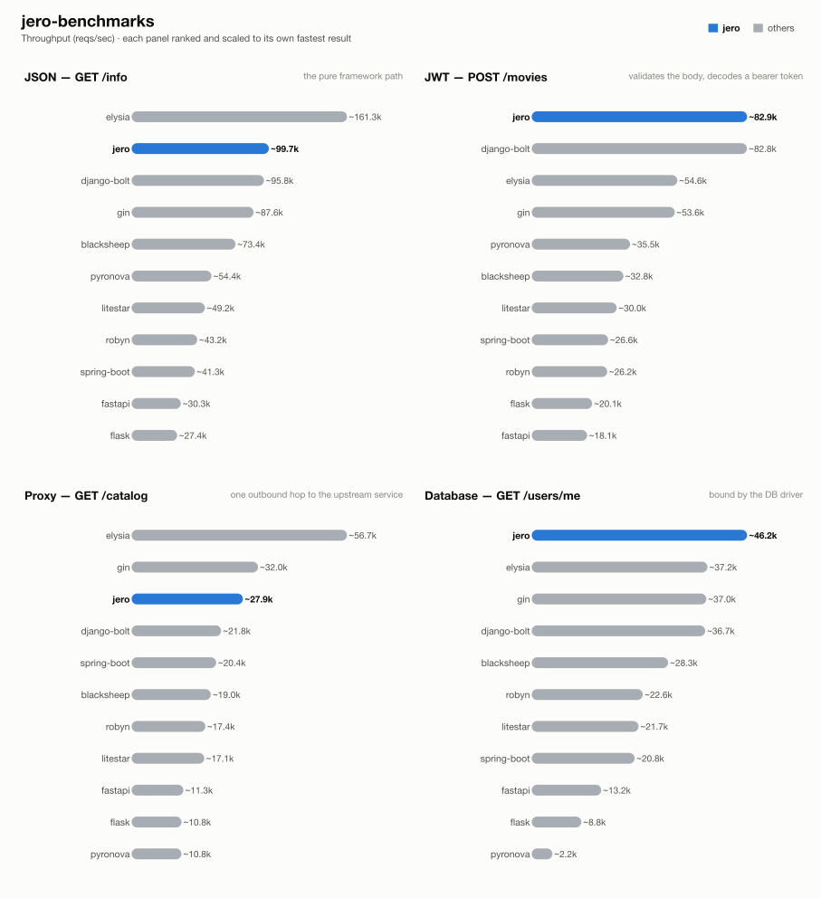

# jero-benchmarks — run `20261023T091453`

_Generated 2026-10-23T11:39:15+00:00_

## Run configuration

| | |
| --- | --- |
| **Run ID** | `20261023T091453` |
| **Created** | 2026-10-23 09:16:23 UTC |
| **Host** | ip-172-31-27-118.eu-central-1.compute.internal |
| **AWS region** | eu-central-1 |
| **EC2 instance type** | c9g.2xlarge |
| **EC2 AMI** | `ami-0f7d895aa37851cb2` |
| **Images** | `blacksheep-2026.10.23.02`, `django-bolt-2026.10.23.02`, `elysia-2026.10.23.01`, `fastapi-2026.10.23.02`, `flask-2026.10.23.02`, `gin-2026.10.23.01`, `jero-2026.10.23.02`, `litestar-2026.10.23.02`, `postgres-2026.10.23.01`, `pyronova-2026.10.23.02`, `robyn-2026.10.23.02`, `runner-2026.10.23.02`, `spring-boot-2026.10.23.01`, `upstream-2026.10.23.01` |
| **Load generator** | wrk |
| **Connections** | 128 |
| **Duration per attempt** | 60s |
| **Best of** | 3 |
| **Server workers** | 1 |
| **Python server** | peregrine |
| **Event loop** | uvloop |
| **Frameworks** | blacksheep, django-bolt, elysia, fastapi, flask, gin, jero, litestar, pyronova, robyn, spring-boot |
| **Results backend** | TaglyDB |

## Results

### 1 - GET /info

| Framework | req/s | vs | mean | vs | p99 | vs | succ% | memPk | memAv | cpuAv | cpuPk | cpu ~ | mem ~ |
| --- | --- | --- | --- | --- | --- | --- | --- | --- | --- | --- | --- | --- | --- |
| elysia | ~161.3k | x1.62 | 0.79ms | x1.61 | 1.43ms | x0.93 | 100.00 | 23M | 21M | 97% | 102% | ▇▇▇▇▇▇█▇▇▇▇▇▇▇▇▄ | ▇▇█▇▇▇▇▇▇▇▇▇▇▇▇▆ |
| jero | ~99.7k | x1.00 | 1.27ms | x1.00 | 1.33ms | x1.00 | 100.00 | 50M | 50M | 101% | 102% | █▇▇▇▇▇▇▇▇▇▇▇▇▇▇▇ | ▇▇▇▇▇▇▇▇█▇▇▇▇▇▇▇ |
| django-bolt | ~95.8k | x0.96 | 1.33ms | x0.96 | 1.37ms | x0.97 | 100.00 | 74M | 73M | 98% | 103% | ▇█▇▇▇▇▇▇▇▇▇▇▇▇▇▄ | ▇▇█▇▇▇▇▇▇▇▇▇▇▇▇▇ |
| gin | ~87.6k | x0.88 | 1.47ms | x0.87 | 3.33ms | x0.40 | 100.00 | 10M | 10M | 102% | 103% | ▇▇▇▇▇▇▇▇█▇▇▇▇▇▇▇ | ▇▇▇▇▇██▇▇▇▇▇▇▇▇▇ |
| blacksheep | ~73.4k | x0.74 | 1.74ms | x0.73 | 1.79ms | x0.74 | 100.00 | 52M | 52M | 100% | 101% | ▇█▇▇▇▇▇▇▇▇▇▇▇▇▇▇ | ▇▇▇▇▇▇█▇▇▇▇▇▇▇▇▇ |
| pyronova | ~54.4k | x0.55 | 4.07ms | x0.31 | 25.45ms | x0.05 | 100.00 | 131M | 130M | 98% | 102% | ▇▇▇▇▇▇▇▇▇▇▇▇▇▇█▄ | ▇▇▇▇▇▇▇▇█▇▇▇▇▇▇▇ |
| litestar | ~49.2k | x0.49 | 2.58ms | x0.49 | 2.64ms | x0.50 | 100.00 | 61M | 61M | 97% | 100% | ▇▇▇▇▇▇▇█▇▇▇▇▇▇▇▄ | █▇▇▇▇▇▇▇▇▇▇▇▇▇▇▇ |
| robyn | ~43.2k | x0.43 | 2.96ms | x0.43 | 3.09ms | x0.43 | 100.00 | 40M | 40M | 101% | 102% | ▇▇▇▇▇▇█▇▇▇▇▇▇▇▇▇ | ▇▇▇▇▇▇█▇▇▇▇▇▇▇▇▇ |
| spring-boot | ~41.3k | x0.41 | 3.09ms | x0.41 | 4.88ms | x0.27 | 100.00 | 615M | 614M | 101% | 102% | ▇▇▇▇▇▇█▇▇▇▇▇▇▇▇▇ | █▇▇▇▇▇▇▇▇▇▇▇▇▇▇▇ |
| fastapi | ~30.3k | x0.30 | 4.21ms | x0.30 | 4.30ms | x0.31 | 100.00 | 58M | 58M | 100% | 101% | ▇▇▇▇▇▇▇█▇▇▇▇▇▇▇▇ | ▇█▇▇▇▇▇▇▇▇▇▇▇▇▇▇ |
| flask | ~27.4k | x0.27 | 4.67ms | x0.27 | 4.78ms | x0.28 | 100.00 | 63M | 63M | 97% | 101% | ▇▇▇▇█▇▇▇▇▇▇▇▇▇▇▄ | ████▇▇▇▇▇▇▇▇▇▇▇▇ |

### 2 - POST /movies (JWT)

| Framework | req/s | vs | mean | vs | p99 | vs | succ% | memPk | memAv | cpuAv | cpuPk | cpu ~ | mem ~ |
| --- | --- | --- | --- | --- | --- | --- | --- | --- | --- | --- | --- | --- | --- |
| jero | ~82.9k | x1.00 | 1.53ms | x1.00 | 1.59ms | x1.00 | 100.00 | 51M | 50M | 97% | 102% | ▇▇▇▇▇▇▇▇▇▇▇▇▇▇█▄ | █▇▇▇▇▇▇▇▇▇▇▇▇▇▇▇ |
| django-bolt | ~82.8k | x1.00 | 1.54ms | x0.99 | 1.58ms | x1.01 | 100.00 | 74M | 73M | 101% | 103% | ▇▇▇▇▇▇▇█▇▇▇▇▇▇▇▇ | ▇▇▇▇▇▇▇▇█▇▇▇▇▇▇▇ |
| elysia | ~54.6k | x0.66 | 2.34ms | x0.65 | 4.19ms | x0.38 | 100.00 | 30M | 29M | 101% | 102% | ▇▇▇▇▇▇▇▇▇█▇▇▇▇▇▇ | ▇▇▇▇▇▇▇▇▇▇█▇▇▇▇▇ |
| gin | ~53.6k | x0.65 | 2.39ms | x0.64 | 5.10ms | x0.31 | 100.00 | 10M | 10M | 101% | 103% | ▇▇▇█▇▇▇▇▇▇▇▇▇▇▇▇ | ████████████▇▇▇▇ |
| pyronova | ~35.5k | x0.43 | 4.00ms | x0.38 | 24.56ms | x0.06 | 100.00 | 246M | 244M | 98% | 102% | ▇▇▇▇▇▇▇▇▇▇▇▇█▇▇▄ | ▇▇▇▇▇▇▇▇▇▇▇▇▇▇█▇ |
| blacksheep | ~32.8k | x0.40 | 3.89ms | x0.39 | 3.96ms | x0.40 | 100.00 | 53M | 53M | 100% | 101% | ▇█▇▇▇▇▇▇▇▇▇▇▇▇▇▇ | ▇▇▇▇▇▇▇▇▇▇█▇▇▇▇▇ |
| litestar | ~30.0k | x0.36 | 4.23ms | x0.36 | 4.32ms | x0.37 | 100.00 | 61M | 61M | 100% | 101% | ▇▇▇▇▇▇▇▇█▇▇▇▇▇▇▇ | ▇█▇▇▇▇▇▇▇▇▇▇▇▇▇▇ |
| spring-boot | ~26.6k | x0.32 | 4.82ms | x0.32 | 7.35ms | x0.22 | 100.00 | 633M | 632M | 101% | 103% | ▇▇▇▇█▇▇▇▇▇▇▇▇▇▇▇ | ▇▇▇▇▇▇█▇▇▇▇▇▇▇▇▇ |
| robyn | ~26.2k | x0.32 | 4.88ms | x0.31 | 4.97ms | x0.32 | 100.00 | 40M | 40M | 101% | 102% | ▇▇█▇▇▇▇▇▇▇▇▇▇▇▇▇ | ▇█▇▇▇▇▇▇▇▇▇▇▇▇▇▇ |
| flask | ~20.1k | x0.24 | 6.35ms | x0.24 | 6.49ms | x0.25 | 100.00 | 63M | 63M | 100% | 102% | ▇▇▇▇▇▇▇▇█▇▇▇▇▇▇▇ | █████████████▇▇▇ |
| fastapi | ~18.1k | x0.22 | 7.06ms | x0.22 | 7.17ms | x0.22 | 100.00 | 58M | 58M | 97% | 101% | ▇▇▇▇▇▇▇▇█▇▇▇▇▇▇▄ | ▇▇▇█▇▇█▇▇▇▇▇▇▇▇▇ |

### 3 - GET proxy (upstream)

| Framework | req/s | vs | mean | vs | p99 | vs | succ% | memPk | memAv | cpuAv | cpuPk | cpu ~ | mem ~ |
| --- | --- | --- | --- | --- | --- | --- | --- | --- | --- | --- | --- | --- | --- |
| elysia | ~56.7k | x2.04 | 2.25ms | x2.04 | 3.71ms | x2.18 | 100.00 | 26M | 25M | 101% | 104% | ▇▇▇▇█▇▇▇▇▇▇▇▇▇▇▇ | ▇▇▇▇▇▇▇▇▇▇▇▇▇█▇▇ |
| gin | ~32.0k | x1.15 | 3.99ms | x1.15 | 7.30ms | x1.11 | 100.00 | 15M | 14M | 101% | 103% | ▇▇▇▇▇▇█▇▇▇▇▇▇▇▇▇ | █▇▇▇▇▇▇▇▇▇▇▇▇▇▇▇ |
| jero | ~27.9k | x1.00 | 4.60ms | x1.00 | 8.09ms | x1.00 | 100.00 | 69M | 69M | 101% | 102% | ▇▇▇▇▇▇▇▇▇▇▇▇█▇▇▇ | █▇▇▇▇▇▇▇▇▇▇▇▇▇▇▇ |
| django-bolt | ~21.8k | x0.78 | 5.92ms | x0.78 | 12.86ms | x0.63 | 100.00 | 101M | 98M | 97% | 102% | ▇▇▇▇▇▇▇▇▇▇▇▇█▇▇▄ | █▇▇▇▇▇▇▇▇▇▇▇▇▇▇▇ |
| spring-boot | ~20.4k | x0.73 | 6.25ms | x0.74 | 9.64ms | x0.84 | 100.00 | 676M | 676M | 101% | 102% | ▇▇▇▇▇▇▇▇▇▇▇▇▇▇█▇ | ▇▇▇▇▇▇▇▇▇▇▇▇▇▇▇█ |
| blacksheep | ~19.0k | x0.68 | 6.75ms | x0.68 | 12.64ms | x0.64 | 100.00 | 70M | 70M | 100% | 102% | █▇▇▇▇▇▇▇▇▇▇▇▇▇▇▇ | ▇▇▇▇▇▇▇█▇▇▇▇▇▇▇▇ |
| robyn | ~17.4k | x0.63 | 7.33ms | x0.63 | 11.15ms | x0.73 | 100.00 | 60M | 60M | 100% | 101% | ▇▇▇▇▇▇▇▇▇▇▇▇█▇▇▇ | ▇▇▇▇▇▇▇█▇▇▇▇▇▇▇▇ |
| litestar | ~17.1k | x0.62 | 7.50ms | x0.61 | 17.56ms | x0.46 | 100.00 | 79M | 78M | 100% | 101% | ▇▇▇▇▇▇▇▇▇▇▇▇▇▇▇█ | ▇▇█▇▇▇▇▇▇▇▇▇▇▇▇▇ |
| fastapi | ~11.3k | x0.41 | 11.29ms | x0.41 | 22.42ms | x0.36 | 100.00 | 76M | 73M | 97% | 102% | ▇▇▇▇▇▇▇▇▇▇█▇▇▇▇▄ | █▇▇▇▇▇▇▇▇▇▇▇▇▇▇▇ |
| flask | ~10.8k | x0.39 | 11.79ms | x0.39 | 12.46ms | x0.65 | 100.00 | 64M | 63M | 91% | 94% | ▇▇▇▇█▇▇▇▇▇▇█▇▇▇▄ | █▇▇▇▇▇▇▇▇▇▇▇▇▇▇▇ |
| pyronova | ~10.8k | x0.39 | 11.82ms | x0.39 | 19.36ms | x0.42 | 100.00 | 554M | 548M | 100% | 101% | ▇█▇▇▇▇▇▇▇▇▇▇▇▇▇▇ | ▇▇█▇▇▇▇▇▇▇▇▇▇▇▇▇ |

### 4 - GET /users/me (DB)

| Framework | req/s | vs | mean | vs | p99 | vs | succ% | memPk | memAv | cpuAv | cpuPk | cpu ~ | mem ~ |
| --- | --- | --- | --- | --- | --- | --- | --- | --- | --- | --- | --- | --- | --- |
| jero | ~46.2k | x1.00 | 2.77ms | x1.00 | 3.31ms | x1.00 | 100.00 | 70M | 70M | 100% | 102% | ▇▇▇▇▇▇▇▇█▇▇▇▇▇▇▇ | ▇▇▇▇▇▇▇▇▇▇█▇▇▇▇▇ |
| elysia | ~37.2k | x0.81 | 3.44ms | x0.80 | 6.60ms | x0.50 | 100.00 | 32M | 31M | 100% | 104% | ▇▇▇█▇▇▇▇▇▇▇▇▇▇▇▇ | ▇▇▇▇▇▇▇▇▇▇▇▇▇▇█▇ |
| gin | ~37.0k | x0.80 | 3.48ms | x0.79 | 7.79ms | x0.43 | 100.00 | 29M | 29M | 98% | 104% | ▇▇▇▇▇█▇▇▇▇▇▇▇▇▇▄ | ██▇▇▇▇▇▇▇▇▇▇▇▇▇▇ |
| django-bolt | ~36.7k | x0.80 | 3.48ms | x0.80 | 4.35ms | x0.76 | 100.00 | 103M | 103M | 101% | 106% | ▇▇▇▇▇▇▇▇█▇▇▇▇▇▇▇ | ██▇▇▇▇▇▇▇▇▇▇▇▇▇▇ |
| blacksheep | ~28.3k | x0.61 | 4.51ms | x0.61 | 5.64ms | x0.59 | 100.00 | 73M | 72M | 97% | 103% | ▆▇▇█▇▇▇▇▇▇▇▇▇▇▇▄ | █▇▇▇▇▇▇▇▇▇▇▇▇▇▇▇ |
| robyn | ~22.6k | x0.49 | 5.65ms | x0.49 | 8.56ms | x0.39 | 100.00 | 64M | 64M | 98% | 103% | ▇▇▇▇▇▇▇▇▇█▇▇▇▇▇▄ | █▇▇▇▇▇▇▇▇▇▇▇▇▇▇▇ |
| litestar | ~21.7k | x0.47 | 5.93ms | x0.47 | 10.92ms | x0.30 | 100.00 | 80M | 79M | 101% | 103% | ▇▇▇▇▇▇▇▇▇▇█▇▇▇▇▇ | ▇▇█▇▇▇▇▇▇▇▇▇▇▇▇▇ |
| spring-boot | ~20.8k | x0.45 | 6.15ms | x0.45 | 9.72ms | x0.34 | 100.00 | 684M | 683M | 101% | 104% | ▇▇▇▇▇▇▇▇▇█▇▇▇▇▇▇ | ▇▇▇▇▇▇▇▇▇▇█▇▇▇▇▇ |
| fastapi | ~13.2k | x0.29 | 9.67ms | x0.29 | 20.32ms | x0.16 | 100.00 | 76M | 76M | 97% | 102% | ▇▇▇▇▇█▇▇▇▇▇▇▇▇▇▄ | ▇█▇▇▇▇▇▇▇▇▇▇▇▇▇▇ |
| flask | ~8.8k | x0.19 | 14.59ms | x0.19 | 16.05ms | x0.21 | 100.00 | 63M | 63M | 79% | 79% | ▇█▇▇▇▇▇▇▇▇▇▇▇▇▇▇ | ███████████████▇ |
| pyronova | ~2.2k | x0.05 | 58.09ms | x0.05 | 134.97ms | x0.02 | 81.32 | 617M | 616M | 101% | 103% | █▇▇▇▇▇▇▇▇▇▇▇▇▇▇▇ | ▇█▇▇▇▇▇▇▇▇▇▇▇▇▇▇ |

## How these results were made

**Isolation.** Exactly one framework container is ever alive at a time, alongside
the shared Postgres/upstream/load-generator infra -- brought up via `compose.base.yml`
plus that framework's own `compose.<fw>.yml`, torn down before the next framework
starts. No two frameworks ever share a core or contend for host resources.

**One worker, one core.** Every service runs exactly 1 worker (peregrine
`--workers 1`, Gin `GOMAXPROCS=1`, Bun's single JS thread, Bolt `--processes 1`),
pinned to one dedicated CPU core via `cpuset` affinity -- not a CFS quota, which
throttles a saturated container every 100ms scheduler period and adds
tail-latency stalls; affinity confines all of a framework's threads (including
GIL-releasing extensions like `msgspec`/`fastpg`) to one core with no such stalls.

**Equal resource budgets.** DB pool and outbound-HTTP pool are capped at **64**
connections for every framework/language.

**Load generator.** wrk (C) or oha (Rust), on two dedicated cores -- fast
enough that the framework, not the load generator, is what saturates.

**Best of N.** Each (framework, test) pair starts with an untimed 3s warm-up,
then runs multiple attempts; the attempt with the highest req/s is kept.

**Success %** is the share of requests that got the expected status. Before
the load, a correctness pass also checks the *body* of 100 responses (key
fields per test); if any is wrong, the whole test is reported as 0% success,
so a fast-but-wrong response can never pass as a success.

**Resource-use columns.** `memPk`/`memAv` = peak/average resident memory (MB);
`cpuAv`/`cpuPk` = average/peak CPU as % of one core (pinned via `cpuset`, so
these sit ≤100%); `cpu ~`/`mem ~` = a 0-to-max-scaled sparkline of the CPU/memory
time series during the attempt. Only the framework's own container is measured
-- Postgres and the upstream are excluded.

**Equal work, per test** -- every framework does the same task; only the
*native* tool differs:

| Framework | Language | Server | HTTP client | DB driver | Validates body (test 2) | Parses upstream (test 3) | JSON serializer |
| --- | --- | --- | --- | --- | --- | --- | --- |
| blacksheep | Python 3.14 | peregrine ASGI | lothc | fastpg | pydantic (FromJSON) | typed (pydantic) | stdlib json (BlackSheep default) |
| django-bolt | Python 3.14 | built-in Rust server | lothc | fastpg | msgspec Struct | typed (msgspec) + response re-validate | msgspec |
| elysia | Bun / TS | Bun native | fetch | Bun SQL | typebox schema | passthrough object | Bun native |
| fastapi | Python 3.14 | peregrine ASGI | lothc | fastpg | pydantic | typed (pydantic) + response-model re-validate | pydantic |
| flask | Python 3.14 | peregrine WSGI | lothc (sync) | psycopg | pydantic | typed (pydantic) | stdlib json |
| gin | Go | net/http (GOMAXPROCS=1) | net/http | pgx | ShouldBindJSON struct | typed struct | encoding/json |
| jero | Python 3.14 | peregrine ASGI | lothc | fastpg | msgspec Struct | typed (msgspec) | msgspec |
| litestar | Python 3.14 | peregrine ASGI | lothc | fastpg | msgspec Struct | typed (msgspec) | msgspec |
| pyronova | Python 3.14 | built-in Rust server (gil mode) | lothc | fastpg | pydantic (native model=) | typed (pydantic) | Pyronova native (dicts) / pydantic |
| robyn | Python 3.14 | built-in Rust server | lothc | fastpg | pydantic (native param) | typed (pydantic) | orjson (dicts) / pydantic |
| spring-boot | Java 25 | embedded Tomcat, virtual threads | RestClient (Apache HttpClient5) | JdbcTemplate (HikariCP) | jakarta bean validation (record) | typed (Jackson) | Jackson |

**One deliberate exception to per-framework idiom:** Django Bolt
reaches Postgres through raw fastpg -- the same driver the rest of the async
Python fleet uses -- rather than Django's ORM, whose sync-driver-behind-an-async-facade
design would make test 4 a measurement of Django's data layer instead of the
framework. For the same reason, every JWT endpoint hand-decodes the bearer
token with ryjwt rather than using each framework's own auth integration.

**Known, intended differences** (each framework's real idiomatic behaviour, kept
rather than normalised away): the JSON serializer column (stdlib `json` is
slower than msgspec/orjson/native); FastAPI and Django Bolt additionally
re-validate the *response* against its declared model (both frameworks'
default); Elysia returns the upstream payload parsed but unvalidated;
Spring Boot's Jackson binding coerces a numeric field given
as a JSON string rather than rejecting it like pydantic/msgspec do. These are
visible here so a number is never mistaken for pure framework speed.

## Disclosure

The author of this benchmark suite is also the author of [jero](https://pypi.org/project/jero/), one of the frameworks benchmarked here. Every measure above -- equal resource budgets, idiomatic code per framework, isolated single-framework runs, documented intended differences -- applies identically to jero and everyone else; nothing here is tuned in its favor.

---
_Generated by `export_results.py` from `results.is_best` rows in TaglyDB._