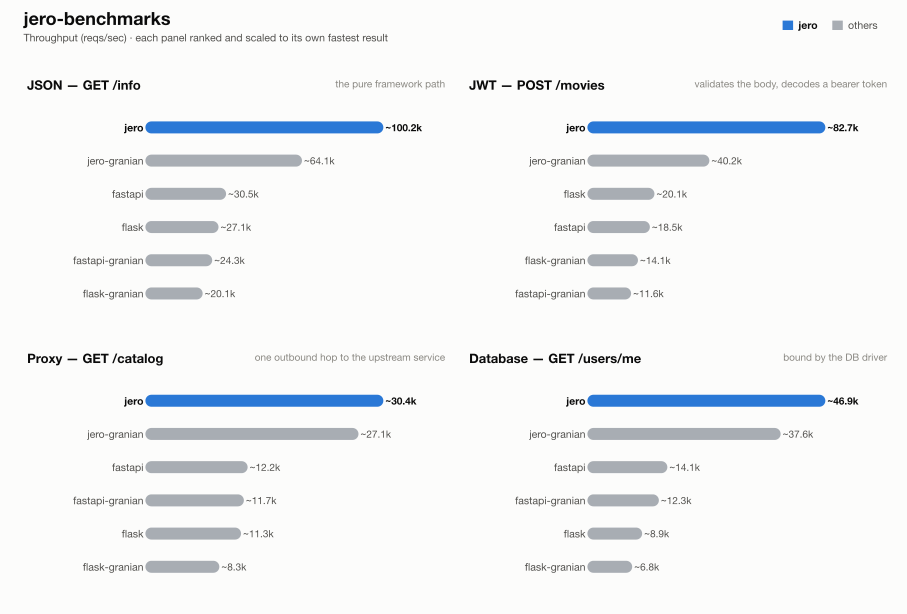

# jero-benchmarks — run `20261023T135721`

_Generated 2026-10-24T08:22:28+00:00_

## Run configuration

| | |
| --- | --- |
| **Run ID** | `20261023T135721` |
| **Created** | 2026-10-23 13:59:19 UTC |
| **Host** | ip-172-31-21-158.eu-central-1.compute.internal |
| **AWS region** | eu-central-1 |
| **EC2 instance type** | c9g.2xlarge |
| **EC2 AMI** | `ami-0f7d895aa37851cb2` |
| **Images** | `fastapi-2026.10.23.04`, `fastapi-granian-2026.10.23.01`, `flask-2026.10.23.04`, `flask-granian-2026.10.23.01`, `jero-2026.10.23.04`, `jero-granian-2026.10.23.01`, `postgres-2026.10.23.01`, `runner-2026.10.23.03`, `upstream-2026.10.23.01` |
| **Load generator** | wrk |
| **Connections** | 128 |
| **Duration per attempt** | 60s |
| **Best of** | 3 |
| **Server workers** | 1 |
| **Python server** | peregrine |
| **Event loop** | uvloop |
| **Frameworks** | fastapi, fastapi-granian, flask, flask-granian, jero, jero-granian |
| **Results backend** | TaglyDB |

## Results

### 1 - GET /info

| Framework | req/s | vs | mean | vs | p99 | vs | succ% | memPk | memAv | cpuAv | cpuPk | cpu ~ | mem ~ |
| --- | --- | --- | --- | --- | --- | --- | --- | --- | --- | --- | --- | --- | --- |
| jero | ~100.2k | x1.00 | 1.27ms | x1.00 | 1.32ms | x1.00 | 100.00 | 50M | 50M | 100% | 103% | ▇▇▇▇▇▇▇▇▇█▇▇▇▇▇▇ | █▇▇▇▇▇▇▇▇▇▇▇▇▇▇▇ |
| jero-granian | ~64.1k | x0.64 | 1.99ms | x0.64 | 3.31ms | x0.40 | 100.00 | 74M | 74M | 101% | 102% | ▇▇▇▇▇▇█▇▇▇▇▇▇▇▇▇ | █▇▇▇▇▇▇▇▇▇▇▇▇▇▇▇ |
| fastapi | ~30.5k | x0.30 | 4.19ms | x0.30 | 4.24ms | x0.31 | 100.00 | 58M | 58M | 97% | 102% | ▇▇▇▇▇▇▇▇█▇▇▇▇▇▇▄ | ▇▇█▇▇▇▇▇▇▇▇▇▇▇▇▇ |
| flask | ~27.1k | x0.27 | 4.71ms | x0.27 | 4.83ms | x0.27 | 100.00 | 63M | 62M | 97% | 102% | ▇▇▇█▇▇▇▇▇▇▇▇▇▇▇▄ | ▇▇▇▇▇█████▇▇▇▇▇▇ |
| fastapi-granian | ~24.3k | x0.24 | 5.26ms | x0.24 | 9.39ms | x0.14 | 100.00 | 82M | 81M | 100% | 101% | ▇▇▇▇▇▇▇▇█▇▇▇▇▇▇▇ | █▇▇▇▇▇▇▇▇▇▇▇▇▇▇▇ |
| flask-granian | ~20.1k | x0.20 | 6.36ms | x0.20 | 11.05ms | x0.12 | 100.00 | 85M | 84M | 98% | 102% | ▇▇▇█▇▇▇▇▇▇▇▇▇▇▇▄ | ▇▇▇▇▇▇▇▇█▇▇▇▇▇▇▇ |

### 2 - POST /movies (JWT)

| Framework | req/s | vs | mean | vs | p99 | vs | succ% | memPk | memAv | cpuAv | cpuPk | cpu ~ | mem ~ |
| --- | --- | --- | --- | --- | --- | --- | --- | --- | --- | --- | --- | --- | --- |
| jero | ~82.7k | x1.00 | 1.54ms | x1.00 | 1.59ms | x1.00 | 100.00 | 51M | 50M | 100% | 102% | ▇▇█▇▇▇▇▇▇▇▇▇▇▇▇▇ | █▇▇▇▇▇▇▇▇▇▇▇▇▇▇▇ |
| jero-granian | ~40.2k | x0.49 | 3.18ms | x0.48 | 4.32ms | x0.37 | 100.00 | 76M | 75M | 97% | 101% | ▇█▇▇▇▇▇▇▇▇▇▇▇▇▇▄ | ▇█▇▇▇▇▇▇▇▇▇▇▇▇▇▇ |
| flask | ~20.1k | x0.24 | 6.35ms | x0.24 | 6.48ms | x0.25 | 100.00 | 63M | 63M | 101% | 102% | ▇▇▇█▇▇▇▇▇▇▇▇▇▇▇▇ | ███▇▇▇▇▇▇▇▇▇▇▇▇▇ |
| fastapi | ~18.5k | x0.22 | 6.90ms | x0.22 | 7.01ms | x0.23 | 100.00 | 59M | 58M | 97% | 101% | ▇▇▇▇▇▇▇▇█▇▇▇▇▇▇▄ | ▇▇█▇▇▇▇▇▇▇▇▇▇▇▇▇ |
| flask-granian | ~14.1k | x0.17 | 9.05ms | x0.17 | 15.47ms | x0.10 | 100.00 | 86M | 85M | 101% | 102% | ▇▇▇▇▇▇▇▇▇█▇▇▇▇▇▇ | ▇█▇▇▇▇▇▇▇▇▇▇▇▇▇▇ |
| fastapi-granian | ~11.6k | x0.14 | 11.03ms | x0.14 | 21.71ms | x0.07 | 100.00 | 85M | 84M | 100% | 101% | █▇▇▇▇▇▇▇▇▇▇▇▇▇▇▇ | ▇▇█▇▇▇▇▇▇▇▇▇▇▇▇▇ |

### 3 - GET proxy (upstream)

| Framework | req/s | vs | mean | vs | p99 | vs | succ% | memPk | memAv | cpuAv | cpuPk | cpu ~ | mem ~ |
| --- | --- | --- | --- | --- | --- | --- | --- | --- | --- | --- | --- | --- | --- |
| jero | ~30.4k | x1.00 | 4.21ms | x1.00 | 7.17ms | x1.00 | 100.00 | 66M | 64M | 97% | 102% | ▇▇▇▇▇▇▇▇▇▇▇▇▇█▇▄ | ▇█▇▇▇▇▇▇▇▇▇▇▇▇▇▇ |
| jero-granian | ~27.1k | x0.89 | 4.73ms | x0.89 | 8.04ms | x0.89 | 100.00 | 89M | 88M | 100% | 103% | ▇▇▇▇▇▇▇▇▇▇▇█▇▇▇▇ | █▇▇▇▇▇▇▇▇▇▇▇▇▇▇▇ |
| fastapi | ~12.2k | x0.40 | 10.52ms | x0.40 | 20.16ms | x0.36 | 100.00 | 74M | 73M | 100% | 101% | ▇▇▇▇▇▇▇▇▇▇█▇▇▇▇▇ | ▇▇▇▇▇▇▇▇▇▇█▇▇▇▇▇ |
| fastapi-granian | ~11.7k | x0.38 | 10.99ms | x0.38 | 23.02ms | x0.31 | 100.00 | 99M | 97M | 100% | 102% | ▇▇▇▇▇▇▇▇█▇▇▇▇▇▇▇ | ▇▇▇▇▇▇▇▇▇▇▇▇▇█▇▇ |
| flask | ~11.3k | x0.37 | 11.33ms | x0.37 | 11.94ms | x0.60 | 100.00 | 63M | 63M | 91% | 94% | ▇▇▇▇▇▇▇▇█▇▇▇▇▇▇▄ | █▇▇▇▇▇▇▇▇▇▇▇▇▇▇▇ |
| flask-granian | ~8.3k | x0.27 | 15.30ms | x0.27 | 16.03ms | x0.45 | 100.00 | 87M | 87M | 96% | 97% | ▇▇▇█▇▇▇▇▇▇▇▇▇▇▇▇ | ▇█▇▇▇▇▇▇▇▇▇▇▇▇▇▇ |

### 4 - GET /users/me (DB)

| Framework | req/s | vs | mean | vs | p99 | vs | succ% | memPk | memAv | cpuAv | cpuPk | cpu ~ | mem ~ |
| --- | --- | --- | --- | --- | --- | --- | --- | --- | --- | --- | --- | --- | --- |
| jero | ~46.9k | x1.00 | 2.73ms | x1.00 | 3.26ms | x1.00 | 100.00 | 66M | 65M | 101% | 107% | ▇▇▇▇▇▇▇▇▇▇█▇▇▇▇▇ | █▇▇▇▇▇▇▇▇▇▇▇▇▇▇▇ |
| jero-granian | ~37.6k | x0.80 | 3.43ms | x0.79 | 7.65ms | x0.43 | 100.00 | 91M | 90M | 97% | 107% | ▇▇▇▇▇▇▇▇▇▇▇▇▇▇█▄ | ▇█▇▇▇▇▇▇▇▇▇▇▇▇▇▇ |
| fastapi | ~14.1k | x0.30 | 9.05ms | x0.30 | 18.26ms | x0.18 | 100.00 | 77M | 76M | 97% | 102% | ▇▇▇▇▇▇▇▇▇█▇▇▇▇▇▄ | ▇▇▇▇▇▇▇█▇▇▇▇▇▇▇▇ |
| fastapi-granian | ~12.3k | x0.26 | 10.36ms | x0.26 | 21.22ms | x0.15 | 100.00 | 99M | 99M | 103% | 105% | ▇▇▇▇▇▇█▇▇▇▇▇▇▇▇▇ | █▇▇▇▇▇▇▇▇▇▇▇▇▇▇▇ |
| flask | ~8.9k | x0.19 | 14.41ms | x0.19 | 16.02ms | x0.20 | 100.00 | 63M | 63M | 76% | 80% | ▇▇▇▇▇▇▇█▇▇▇▇▇▇▇▄ | █▇▇▇▇▇▇▇▇▇▇▇▇▇▇▇ |
| flask-granian | ~6.8k | x0.15 | 18.79ms | x0.15 | 20.21ms | x0.16 | 100.00 | 87M | 87M | 86% | 87% | ▇▇█▇▇▇▇▇▇▇▇▇▇▇▇▇ | ▇█▇▇▇▇▇▇▇▇▇▇▇▇▇▇ |

## How these results were made

**Isolation.** Exactly one framework container is ever alive at a time, alongside
the shared Postgres/upstream/load-generator infra -- brought up via `compose.base.yml`
plus that framework's own `compose.<fw>.yml`, torn down before the next framework
starts. No two frameworks ever share a core or contend for host resources.

**One worker, one core.** Every service runs exactly 1 worker (peregrine
`--workers 1`, Gin `GOMAXPROCS=1`, Bun's single JS thread, Bolt `--processes 1`),
pinned to one dedicated CPU core via `cpuset` affinity -- not a CFS quota, which
throttles a saturated container every 100ms scheduler period and adds
tail-latency stalls; affinity confines all of a framework's threads (including
GIL-releasing extensions like `msgspec`/`fastpg`) to one core with no such stalls.

**Equal resource budgets.** DB pool and outbound-HTTP pool are capped at **64**
connections for every framework/language.

**Load generator.** wrk (C) or oha (Rust), on two dedicated cores -- fast
enough that the framework, not the load generator, is what saturates.

**Best of N.** Each (framework, test) pair starts with an untimed 3s warm-up,
then runs multiple attempts; the attempt with the highest req/s is kept.

**Success %** is the share of requests that got the expected status. Before
the load, a correctness pass also checks the *body* of 100 responses (key
fields per test); if any is wrong, the whole test is reported as 0% success,
so a fast-but-wrong response can never pass as a success.

**Resource-use columns.** `memPk`/`memAv` = peak/average resident memory (MB);
`cpuAv`/`cpuPk` = average/peak CPU as % of one core (pinned via `cpuset`, so
these sit ≤100%); `cpu ~`/`mem ~` = a 0-to-max-scaled sparkline of the CPU/memory
time series during the attempt. Only the framework's own container is measured
-- Postgres and the upstream are excluded.

**Equal work, per test** -- every framework does the same task; only the
*native* tool differs:

| Framework | Language | Server | HTTP client | DB driver | Validates body (test 2) | Parses upstream (test 3) | JSON serializer |
| --- | --- | --- | --- | --- | --- | --- | --- |
| fastapi | Python 3.14 | peregrine ASGI | lothc | fastpg | pydantic | typed (pydantic) + response-model re-validate | pydantic |
| flask | Python 3.14 | peregrine WSGI | lothc (sync) | psycopg | pydantic | typed (pydantic) | stdlib json |
| jero | Python 3.14 | peregrine ASGI | lothc | fastpg | msgspec Struct | typed (msgspec) | msgspec |

**One deliberate exception to per-framework idiom:** Django Bolt
reaches Postgres through raw fastpg -- the same driver the rest of the async
Python fleet uses -- rather than Django's ORM, whose sync-driver-behind-an-async-facade
design would make test 4 a measurement of Django's data layer instead of the
framework. For the same reason, every JWT endpoint hand-decodes the bearer
token with ryjwt rather than using each framework's own auth integration.

**Known, intended differences** (each framework's real idiomatic behaviour, kept
rather than normalised away): the JSON serializer column (stdlib `json` is
slower than msgspec/orjson/native); FastAPI and Django Bolt additionally
re-validate the *response* against its declared model (both frameworks'
default); Elysia returns the upstream payload parsed but unvalidated;
Spring Boot's Jackson binding coerces a numeric field given
as a JSON string rather than rejecting it like pydantic/msgspec do. These are
visible here so a number is never mistaken for pure framework speed.

## Disclosure

The author of this benchmark suite is also the author of [jero](https://pypi.org/project/jero/), one of the frameworks benchmarked here. Every measure above -- equal resource budgets, idiomatic code per framework, isolated single-framework runs, documented intended differences -- applies identically to jero and everyone else; nothing here is tuned in its favor.

---
_Generated by `export_results.py` from `results.is_best` rows in TaglyDB._