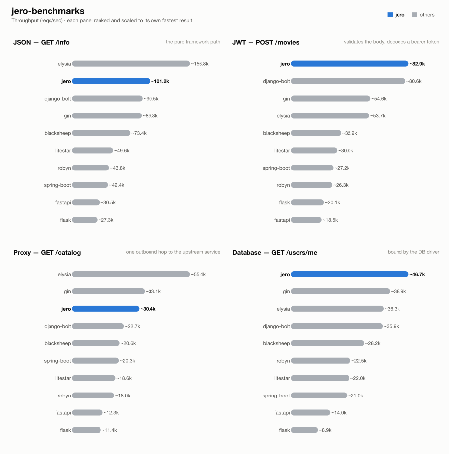

# jero-benchmarks — run `20261025T073117`

_Generated 2026-10-25T13:41:24+00:00_

## Run configuration

| | |
| --- | --- |
| **Run ID** | `20261025T073117` |
| **Created** | 2026-10-25 07:34:05 UTC |
| **Host** | ip-172-31-26-48.eu-central-1.compute.internal |
| **AWS region** | eu-central-1 |
| **EC2 instance type** | c9g.2xlarge |
| **EC2 AMI** | `ami-0f7d895aa37851cb2` |
| **Commit** | [`469c5ac03cdd`](https://github.com/RogerThomas/api-benchmarks/commit/469c5ac03cddb346d9f8f9fcfa014819d16bef11), [`83b8e0d1139a`](https://github.com/RogerThomas/api-benchmarks/commit/83b8e0d1139a34eac35f29a3ea343c1b0ef2805d) |
| **Images** | `blacksheep-2026.10.25.01`, `django-bolt-2026.10.25.01`, `elysia-2026.10.23.01`, `fastapi-2026.10.25.03`, `flask-2026.10.25.01`, `gin-2026.10.25.01`, `jero-2026.10.25.01`, `litestar-2026.10.25.01`, `postgres-2026.10.23.01`, `robyn-2026.10.25.01`, `runner-2026.10.25.01`, `spring-boot-2026.10.25.01`, `upstream-2026.10.25.01` |
| **Load generator** | wrk |
| **Connections** | 128 |
| **Duration per attempt** | 60s |
| **Best of** | 3 |
| **Server workers** | 1 |
| **Python server** | peregrine |
| **Event loop** | uvloop |
| **Frameworks** | blacksheep, django-bolt, elysia, fastapi, flask, gin, jero, litestar, robyn, spring-boot |
| **Results backend** | TaglyDB |

## Results

### 1 - GET /info

| Framework | req/s | vs | mean | vs | p99 | vs | succ% | memPk | memAv | cpuAv | cpuPk | cpu ~ | mem ~ |
| --- | --- | --- | --- | --- | --- | --- | --- | --- | --- | --- | --- | --- | --- |
| elysia | ~156.8k | x1.55 | 0.82ms | x1.54 | 1.46ms | x0.89 | 100.00 | 20M | 20M | 101% | 102% | ▇▇▇▇▇▇▇▇▇▇▇▇▇█▇▇ | ▇▇▇▇▇▇▇█▇▇▇▇▇▇▇▇ |
| jero | ~101.2k | x1.00 | 1.26ms | x1.00 | 1.30ms | x1.00 | 100.00 | 43M | 43M | 97% | 103% | ▇▇█▇▇▇▇▇▇▇▇▇▇▇▇▄ | █▇▇▇▇▇▇▇▇▇▇▇▇▇▇▇ |
| django-bolt | ~90.5k | x0.89 | 1.41ms | x0.89 | 1.45ms | x0.90 | 100.00 | 69M | 69M | 101% | 104% | ▇▇▇█▇▇▇▇▇▇▇▇▇▇▇▇ | █▇▇▇▇▇▇▇▇▇▇▇▇▇▇▇ |
| gin | ~89.3k | x0.88 | 1.44ms | x0.87 | 3.25ms | x0.40 | 100.00 | 10M | 10M | 98% | 102% | ▇▇▇█▇▇▇▇▇▇▇▇▇▇▇▄ | █▇▇▇▇▇▇▇▇▇▇▇▇▇▇▇ |
| blacksheep | ~73.4k | x0.73 | 1.73ms | x0.73 | 1.78ms | x0.73 | 100.00 | 51M | 51M | 100% | 102% | ▇▇▇█▇▇▇▇▇▇▇▇▇▇▇▇ | ▇▇▇▇█▇▇▇▇▇▇▇▇▇▇▇ |
| litestar | ~49.6k | x0.49 | 2.56ms | x0.49 | 2.62ms | x0.50 | 100.00 | 52M | 52M | 100% | 101% | ▇▇▇▇▇▇▇▇▇█▇▇▇▇▇▇ | ▇█▇▇▇▇▇▇▇▇▇▇▇▇▇▇ |
| robyn | ~43.8k | x0.43 | 2.92ms | x0.43 | 3.02ms | x0.43 | 100.00 | 39M | 39M | 101% | 102% | ▇▇▇▇█▇▇▇▇▇▇▇▇▇▇▇ | ▇▇▇▇▇▇▇▇▇▇▇▇▇█▇▇ |
| spring-boot | ~42.4k | x0.42 | 3.01ms | x0.42 | 4.81ms | x0.27 | 100.00 | 612M | 611M | 101% | 103% | ▇▇▇█▇▇▇▇▇▇▇▇▇▇▇▇ | █▇▇▇▇▇▇▇▇▇▇▇▇▇▇▇ |
| fastapi | ~30.5k | x0.30 | 4.18ms | x0.30 | 4.24ms | x0.31 | 100.00 | 57M | 56M | 100% | 101% | ▇▇▇█▇▇▇▇▇▇▇▇▇▇▇▇ | ▇▇▇▇█▇▇▇▇▇▇▇▇▇▇▇ |
| flask | ~27.3k | x0.27 | 4.68ms | x0.27 | 4.79ms | x0.27 | 100.00 | 61M | 61M | 97% | 102% | ▆▇▇█▇▇▇▇▇▇▇▇▇▇▇▄ | █▇▇▇▇▇▇▇▇▇▇▇▇▇▇▇ |

### 2 - POST /movies (JWT)

| Framework | req/s | vs | mean | vs | p99 | vs | succ% | memPk | memAv | cpuAv | cpuPk | cpu ~ | mem ~ |
| --- | --- | --- | --- | --- | --- | --- | --- | --- | --- | --- | --- | --- | --- |
| jero | ~82.9k | x1.00 | 1.53ms | x1.00 | 1.58ms | x1.00 | 100.00 | 44M | 44M | 100% | 103% | ▇▇▇▇▇▇▇▇▇▇▇▇▇▇▇█ | ▇▇▇▇▇▇▇▇▇▇▇█▇▇▇▇ |
| django-bolt | ~80.6k | x0.97 | 1.59ms | x0.97 | 1.62ms | x0.97 | 100.00 | 69M | 69M | 98% | 103% | ▇▇▇▇▇█▇▇▇▇▇▇▇▇▇▄ | █▇▇▇▇▇▇▇▇▇▇▇▇▇▇▇ |
| gin | ~54.6k | x0.66 | 2.35ms | x0.65 | 5.01ms | x0.32 | 100.00 | 10M | 10M | 101% | 103% | ▇▇▇▇▇▇▇▇▇▇▇▇▇▇▇█ | ▇▇▇▇▇▇█▇▇▇▇▇▇▇▇▇ |
| elysia | ~53.7k | x0.65 | 2.38ms | x0.64 | 4.26ms | x0.37 | 100.00 | 29M | 28M | 100% | 102% | ▇▇▇▇▇▇▇▇▇█▇▇▇▇▇▇ | ▇▇▇▇▇▇▇▇▇▇█▇▇▇▇▇ |
| blacksheep | ~32.9k | x0.40 | 3.88ms | x0.40 | 3.95ms | x0.40 | 100.00 | 51M | 51M | 100% | 101% | ▇▇▇▇▇▇█▇▇▇▇▇▇▇▇▇ | █▇▇▇▇▇▇▇▇▇▇▇▇▇▇▇ |
| litestar | ~30.0k | x0.36 | 4.25ms | x0.36 | 4.32ms | x0.37 | 100.00 | 52M | 52M | 100% | 102% | ▇▇▇▇▇▇▇▇▇▇█▇▇▇▇▇ | ▇▇█▇▇▇▇▇▇▇▇▇▇▇▇▇ |
| spring-boot | ~27.2k | x0.33 | 4.70ms | x0.33 | 7.24ms | x0.22 | 100.00 | 635M | 635M | 101% | 103% | ▇▇▇█▇▇▇▇▇▇▇▇▇▇▇▇ | ▇▇█▇▇▇▇▇▇▇▇▇▇▇▇▇ |
| robyn | ~26.3k | x0.32 | 4.86ms | x0.32 | 4.93ms | x0.32 | 100.00 | 40M | 40M | 97% | 101% | ▇▇▇▇▇▇▇▇▇▇▇▇▇█▇▄ | █▇▇▇▇▇▇▇▇▇▇▇▇▇▇▇ |
| flask | ~20.1k | x0.24 | 6.35ms | x0.24 | 6.48ms | x0.24 | 100.00 | 61M | 61M | 100% | 102% | ▇▇▇▇▇▇▇▇█▇▇▇▇▇▇▇ | █████████▇▇▇▇▇▇▇ |
| fastapi | ~18.5k | x0.22 | 6.91ms | x0.22 | 6.98ms | x0.23 | 100.00 | 57M | 57M | 97% | 101% | ▇▇▇▇▇▇▇▇▇▇▇█▇▇▇▄ | █▇▇▇▇▇▇▇▇▇▇▇▇▇▇▇ |

### 3 - GET proxy (upstream)

| Framework | req/s | vs | mean | vs | p99 | vs | succ% | memPk | memAv | cpuAv | cpuPk | cpu ~ | mem ~ |
| --- | --- | --- | --- | --- | --- | --- | --- | --- | --- | --- | --- | --- | --- |
| elysia | ~55.4k | x1.82 | 2.31ms | x1.82 | 3.79ms | x1.88 | 100.00 | 28M | 26M | 101% | 103% | █▇▇▇▇▇▇▇▇▇▇▇▇▇▇▇ | ▇▇▇▇▇▇▇▇█▇▇▇▇▇▇▇ |
| gin | ~33.1k | x1.09 | 3.87ms | x1.09 | 7.05ms | x1.01 | 100.00 | 14M | 14M | 101% | 102% | ▇▇▇▇▇▇▇▇▇▇▇▇█▇▇▇ | ▇█▇▇▇▇▇▇▇▇▇▇▇▇▇▇ |
| jero | ~30.4k | x1.00 | 4.21ms | x1.00 | 7.13ms | x1.00 | 100.00 | 56M | 56M | 101% | 103% | ▇▇▇▇▇▇▇▇▇█▇▇▇▇▇▇ | ▇▇▇▇▇▇▇▇▇▇▇█▇▇▇▇ |
| django-bolt | ~22.7k | x0.75 | 5.66ms | x0.74 | 11.98ms | x0.59 | 100.00 | 90M | 89M | 100% | 101% | ▇▇▇▇▇█▇▇▇▇▇▇▇▇▇▇ | ▇▇▇▇▇▇▇▇▇▇▇▇▇█▇▇ |
| blacksheep | ~20.6k | x0.68 | 6.20ms | x0.68 | 11.55ms | x0.62 | 100.00 | 76M | 69M | 97% | 102% | ▇▇▇▇▇▇▇▇▇█▇▇▇▇▇▄ | ▇█▇▇▇▇▇▇▇▇▇▇▇▇▇▇ |
| spring-boot | ~20.3k | x0.67 | 6.29ms | x0.67 | 9.33ms | x0.76 | 100.00 | 662M | 661M | 101% | 103% | ▇▇▇▇▇▇▇▇▇▇▇▇█▇▇▇ | ▇▇▇▇▇▇▇▇▇▇▇█▇▇▇▇ |
| litestar | ~18.6k | x0.61 | 6.89ms | x0.61 | 14.05ms | x0.51 | 100.00 | 66M | 65M | 101% | 102% | ▇▇▇▇▇▇▇▇▇▇▇▇▇█▇▇ | ▇▇▇▇▇▇▇▇█▇▇▇▇▇▇▇ |
| robyn | ~18.0k | x0.59 | 7.12ms | x0.59 | 10.82ms | x0.66 | 100.00 | 59M | 59M | 100% | 101% | ▇▇▇▇▇▇▇█▇▇▇▇▇▇▇▇ | █▇▇▇▇▇▇▇▇▇▇▇▇▇▇▇ |
| fastapi | ~12.3k | x0.40 | 10.42ms | x0.40 | 20.05ms | x0.36 | 100.00 | 70M | 70M | 100% | 102% | ▇▇▇▇▇▇▇▇▇▇▇▇▇▇█▇ | ▇▇▇▇▇▇▇▇▇▇▇▇▇▇▇█ |
| flask | ~11.4k | x0.37 | 11.24ms | x0.37 | 11.88ms | x0.60 | 100.00 | 61M | 61M | 93% | 94% | ▇▇▇▇▇▇▇▇▇▇▇▇▇█▇▇ | █▇▇▇▇▇▇▇▇▇▇▇▇▇▇▇ |

### 4 - GET /users/me (DB)

| Framework | req/s | vs | mean | vs | p99 | vs | succ% | memPk | memAv | cpuAv | cpuPk | cpu ~ | mem ~ |
| --- | --- | --- | --- | --- | --- | --- | --- | --- | --- | --- | --- | --- | --- |
| jero | ~46.7k | x1.00 | 2.73ms | x1.00 | 3.28ms | x1.00 | 100.00 | 60M | 60M | 101% | 103% | ▇▇▇▇▇▇▇▇▇▇▇▇▇▇█▇ | ▇█▇▇▇▇▇▇▇▇▇▇▇▇▇▇ |
| gin | ~38.9k | x0.83 | 3.29ms | x0.83 | 6.87ms | x0.48 | 100.00 | 28M | 27M | 101% | 104% | ▇▇▇▇▇▇▇▇▇▇█▇▇▇▇▇ | ▇█▇▇▇▇▇▇▇▇▇▇▇▇▇▇ |
| elysia | ~36.3k | x0.78 | 3.52ms | x0.78 | 6.78ms | x0.48 | 100.00 | 34M | 32M | 97% | 104% | ▇▇▇▇█▇▇▇▇▇▇▇▇▇▇▄ | ▇▇▇▇▇▇█▇▇▇▇▇▇▇▇▇ |
| django-bolt | ~35.9k | x0.77 | 3.55ms | x0.77 | 4.36ms | x0.75 | 100.00 | 93M | 93M | 100% | 102% | ▇▇▇▇▇▇▇█▇▇▇▇▇▇▇▇ | ▇█▇▇▇▇▇▇▇▇▇▇▇▇▇▇ |
| blacksheep | ~28.2k | x0.60 | 4.54ms | x0.60 | 5.80ms | x0.57 | 100.00 | 72M | 72M | 97% | 102% | ▇█▇▇▇▇▇▇▇▇▇▇▇▇▇▄ | █▇▇▇▇▇▇▇▇▇▇▇▇▇▇▇ |
| robyn | ~22.5k | x0.48 | 5.70ms | x0.48 | 8.53ms | x0.39 | 100.00 | 63M | 62M | 102% | 104% | ▇▇█▇▇▇▇▇▇▇▇▇▇▇▇▇ | ▇█▇▇▇▇▇▇▇▇▇▇▇▇▇▇ |
| litestar | ~22.0k | x0.47 | 5.81ms | x0.47 | 7.63ms | x0.43 | 100.00 | 69M | 68M | 97% | 103% | ▇▇▇▇▇▇▇▇▇▇▇▇▇█▇▄ | █▇▇█▇▇▇▇▇▇▇▇▇▇▇▇ |
| spring-boot | ~21.0k | x0.45 | 6.08ms | x0.45 | 9.49ms | x0.35 | 100.00 | 676M | 675M | 101% | 103% | ▇▇▇▇▇▇▇█▇▇▇▇▇▇▇▇ | ▇▇▇▇▇▇▇▇▇▇▇▇█▇▇▇ |
| fastapi | ~14.0k | x0.30 | 9.12ms | x0.30 | 18.14ms | x0.18 | 100.00 | 73M | 73M | 97% | 102% | ▆▇▇▇█▇▇▇▇▇▇▇▇▇▇▄ | ▇█▇▇▇▇▇▇▇▇▇▇▇▇▇▇ |
| flask | ~8.9k | x0.19 | 14.37ms | x0.19 | 15.87ms | x0.21 | 100.00 | 61M | 61M | 79% | 80% | ▇▇▇▇▇▇▇▇▇▇▇▇▇▇▇█ | ████████████████ |

## How these results were made

**Isolation.** Exactly one framework container is ever alive at a time, alongside
the shared Postgres/upstream/load-generator infra -- brought up via `compose.base.yml`
plus that framework's own `compose.<fw>.yml`, torn down before the next framework
starts. No two frameworks ever share a core or contend for host resources.

**One worker, one core.** Every service runs exactly 1 worker (peregrine
`--workers 1`, Gin `GOMAXPROCS=1`, Bun's single JS thread, Bolt `--processes 1`),
pinned to one dedicated CPU core via `cpuset` affinity -- not a CFS quota, which
throttles a saturated container every 100ms scheduler period and adds
tail-latency stalls; affinity confines all of a framework's threads (including
GIL-releasing extensions like `msgspec`/`fastpg`) to one core with no such stalls.

**Equal resource budgets.** DB pool and outbound-HTTP pool are capped at **64**
connections for every framework/language.

**Load generator.** wrk (C) or oha (Rust), on two dedicated cores -- fast
enough that the framework, not the load generator, is what saturates.

**Best of N.** Each (framework, test) pair starts with an untimed 3s warm-up,
then runs multiple attempts; the attempt with the highest req/s is kept.

**Success %** is the share of requests that got the expected status. Before
the load, a correctness pass also checks the *body* of 100 responses (key
fields per test); if any is wrong, the whole test is reported as 0% success,
so a fast-but-wrong response can never pass as a success.

**Resource-use columns.** `memPk`/`memAv` = peak/average resident memory (MB);
`cpuAv`/`cpuPk` = average/peak CPU as % of one core (pinned via `cpuset`, so
these sit ≤100%); `cpu ~`/`mem ~` = a 0-to-max-scaled sparkline of the CPU/memory
time series during the attempt. Only the framework's own container is measured
-- Postgres and the upstream are excluded.

**Equal work, per test** -- every framework does the same task; only the
*native* tool differs:

| Framework | Language | Server | HTTP client | DB driver | Validates body (test 2) | Parses upstream (test 3) | JSON serializer |
| --- | --- | --- | --- | --- | --- | --- | --- |
| blacksheep | Python 3.14 | peregrine ASGI | lothc | fastpg | pydantic (FromJSON) | typed (pydantic) | stdlib json (BlackSheep default) |
| django-bolt | Python 3.14 | built-in Rust server | lothc | fastpg | msgspec Struct | typed (msgspec) + response re-validate | msgspec |
| elysia | Bun / TS | Bun native | fetch | Bun SQL | typebox schema | passthrough object | Bun native |
| fastapi | Python 3.14 | peregrine ASGI | lothc | fastpg | pydantic | typed (pydantic) + response-model re-validate | pydantic |
| flask | Python 3.14 | peregrine WSGI | lothc (sync) | psycopg | pydantic | typed (pydantic) | stdlib json |
| gin | Go | net/http (GOMAXPROCS=1) | net/http | pgx | ShouldBindJSON struct | typed struct | encoding/json |
| jero | Python 3.14 | peregrine ASGI | lothc | fastpg | msgspec Struct | typed (msgspec) | msgspec |
| litestar | Python 3.14 | peregrine ASGI | lothc | fastpg | msgspec Struct | typed (msgspec) | msgspec |
| robyn | Python 3.14 | built-in Rust server | lothc | fastpg | pydantic (native param) | typed (pydantic) | orjson (dicts) / pydantic |
| spring-boot | Java 25 | embedded Tomcat, virtual threads | RestClient (Apache HttpClient5) | JdbcTemplate (HikariCP) | jakarta bean validation (record) | typed (Jackson) | Jackson |

**One deliberate exception to per-framework idiom:** Django Bolt
reaches Postgres through raw fastpg -- the same driver the rest of the async
Python fleet uses -- rather than Django's ORM, whose sync-driver-behind-an-async-facade
design would make test 4 a measurement of Django's data layer instead of the
framework. For the same reason, every JWT endpoint hand-decodes the bearer
token with ryjwt rather than using each framework's own auth integration.

**Known, intended differences** (each framework's real idiomatic behaviour, kept
rather than normalised away): the JSON serializer column (stdlib `json` is
slower than msgspec/orjson/native); FastAPI and Django Bolt additionally
re-validate the *response* against its declared model (both frameworks'
default); Elysia returns the upstream payload parsed but unvalidated;
Spring Boot's Jackson binding coerces a numeric field given
as a JSON string rather than rejecting it like pydantic/msgspec do. These are
visible here so a number is never mistaken for pure framework speed.

## Disclosure

The author of this benchmark suite is also the author of [jero](https://pypi.org/project/jero/), one of the frameworks benchmarked here. Every measure above -- equal resource budgets, idiomatic code per framework, isolated single-framework runs, documented intended differences -- applies identically to jero and everyone else; nothing here is tuned in its favor.

---
_Generated by `export_results.py` from `results.is_best` rows in TaglyDB._