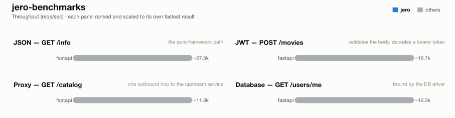

# jero-benchmarks — run `20261025T075303`

_Generated 2026-10-25T08:07:54+00:00_

## Run configuration

| | |
| --- | --- |
| **Run ID** | `20261025T075303` |
| **Created** | 2026-10-25 07:53:43 UTC |
| **Host** | ip-172-31-31-116.eu-central-1.compute.internal |
| **AWS region** | eu-central-1 |
| **EC2 instance type** | c9g.2xlarge |
| **EC2 AMI** | `ami-0f7d895aa37851cb2` |
| **Commit** | [`4b7e4f5a75d9`](https://github.com/RogerThomas/api-benchmarks/commit/4b7e4f5a75d983d46ede09ed501160d01b60c74b) |
| **Images** | `fastapi-2026.10.25.01`, `postgres-2026.10.23.01`, `runner-2026.10.25.01`, `upstream-2026.10.25.01` |
| **Load generator** | wrk |
| **Connections** | 128 |
| **Duration per attempt** | 60s |
| **Best of** | 3 |
| **Server workers** | 1 |
| **Python server** | peregrine |
| **Event loop** | uvloop |
| **Frameworks** | fastapi |
| **Results backend** | TaglyDB |

## Results

### 1 - GET /info

| Framework | req/s | vs | mean | vs | p99 | vs | succ% | memPk | memAv | cpuAv | cpuPk | cpu ~ | mem ~ |
| --- | --- | --- | --- | --- | --- | --- | --- | --- | --- | --- | --- | --- | --- |
| fastapi | ~27.5k | - | 4.64ms | - | 4.72ms | - | 100.00 | 57M | 56M | 100% | 101% | █▇▇▇▇▇▇▇▇▇▇▇▇▇▇▇ | █▇▇▇▇▇▇▇▇▇▇▇▇▇▇▇ |

### 2 - POST /movies (JWT)

| Framework | req/s | vs | mean | vs | p99 | vs | succ% | memPk | memAv | cpuAv | cpuPk | cpu ~ | mem ~ |
| --- | --- | --- | --- | --- | --- | --- | --- | --- | --- | --- | --- | --- | --- |
| fastapi | ~16.7k | - | 7.63ms | - | 8.33ms | - | 100.00 | 57M | 57M | 97% | 101% | ▇▇█▇▇▇▇▇▇▇▇▇▇▇▇▄ | ▇█▇▇▇▇▇▇▇▇▇▇▇▇▇▇ |

### 3 - GET proxy (upstream)

| Framework | req/s | vs | mean | vs | p99 | vs | succ% | memPk | memAv | cpuAv | cpuPk | cpu ~ | mem ~ |
| --- | --- | --- | --- | --- | --- | --- | --- | --- | --- | --- | --- | --- | --- |
| fastapi | ~11.3k | - | 11.35ms | - | 21.43ms | - | 100.00 | 72M | 72M | 100% | 101% | ▇▇▇▇▇▇▇▇▇▇▇▇█▇▇▇ | █▇▇▇▇▇▇▇▇▇▇▇▇▇▇▇ |

### 4 - GET /users/me (DB)

| Framework | req/s | vs | mean | vs | p99 | vs | succ% | memPk | memAv | cpuAv | cpuPk | cpu ~ | mem ~ |
| --- | --- | --- | --- | --- | --- | --- | --- | --- | --- | --- | --- | --- | --- |
| fastapi | ~12.3k | - | 10.38ms | - | 19.62ms | - | 100.00 | 75M | 74M | 100% | 102% | █▇▇▇▇▇▇▇▇▇▇▇▇▇▇▇ | █▇▇▇▇▇▇▇▇▇▇▇▇▇▇▇ |

## How these results were made

**Isolation.** Exactly one framework container is ever alive at a time, alongside
the shared Postgres/upstream/load-generator infra -- brought up via `compose.base.yml`
plus that framework's own `compose.<fw>.yml`, torn down before the next framework
starts. No two frameworks ever share a core or contend for host resources.

**One worker, one core.** Every service runs exactly 1 worker (peregrine
`--workers 1`, Gin `GOMAXPROCS=1`, Bun's single JS thread, Bolt `--processes 1`),
pinned to one dedicated CPU core via `cpuset` affinity -- not a CFS quota, which
throttles a saturated container every 100ms scheduler period and adds
tail-latency stalls; affinity confines all of a framework's threads (including
GIL-releasing extensions like `msgspec`/`fastpg`) to one core with no such stalls.

**Equal resource budgets.** DB pool and outbound-HTTP pool are capped at **64**
connections for every framework/language.

**Load generator.** wrk (C) or oha (Rust), on two dedicated cores -- fast
enough that the framework, not the load generator, is what saturates.

**Best of N.** Each (framework, test) pair starts with an untimed 3s warm-up,
then runs multiple attempts; the attempt with the highest req/s is kept.

**Success %** is the share of requests that got the expected status. Before
the load, a correctness pass also checks the *body* of 100 responses (key
fields per test); if any is wrong, the whole test is reported as 0% success,
so a fast-but-wrong response can never pass as a success.

**Resource-use columns.** `memPk`/`memAv` = peak/average resident memory (MB);
`cpuAv`/`cpuPk` = average/peak CPU as % of one core (pinned via `cpuset`, so
these sit ≤100%); `cpu ~`/`mem ~` = a 0-to-max-scaled sparkline of the CPU/memory
time series during the attempt. Only the framework's own container is measured
-- Postgres and the upstream are excluded.

**Equal work, per test** -- every framework does the same task; only the
*native* tool differs:

| Framework | Language | Server | HTTP client | DB driver | Validates body (test 2) | Parses upstream (test 3) | JSON serializer |
| --- | --- | --- | --- | --- | --- | --- | --- |
| fastapi | Python 3.14 | peregrine ASGI | lothc | fastpg | pydantic | typed (pydantic) + response-model re-validate | pydantic |

**One deliberate exception to per-framework idiom:** Django Bolt
reaches Postgres through raw fastpg -- the same driver the rest of the async
Python fleet uses -- rather than Django's ORM, whose sync-driver-behind-an-async-facade
design would make test 4 a measurement of Django's data layer instead of the
framework. For the same reason, every JWT endpoint hand-decodes the bearer
token with ryjwt rather than using each framework's own auth integration.

**Known, intended differences** (each framework's real idiomatic behaviour, kept
rather than normalised away): the JSON serializer column (stdlib `json` is
slower than msgspec/orjson/native); FastAPI and Django Bolt additionally
re-validate the *response* against its declared model (both frameworks'
default); Elysia returns the upstream payload parsed but unvalidated;
Spring Boot's Jackson binding coerces a numeric field given
as a JSON string rather than rejecting it like pydantic/msgspec do. These are
visible here so a number is never mistaken for pure framework speed.

## Disclosure

The author of this benchmark suite is also the author of [jero](https://pypi.org/project/jero/), one of the frameworks benchmarked here. Every measure above -- equal resource budgets, idiomatic code per framework, isolated single-framework runs, documented intended differences -- applies identically to jero and everyone else; nothing here is tuned in its favor.

---
_Generated by `export_results.py` from `results.is_best` rows in TaglyDB._