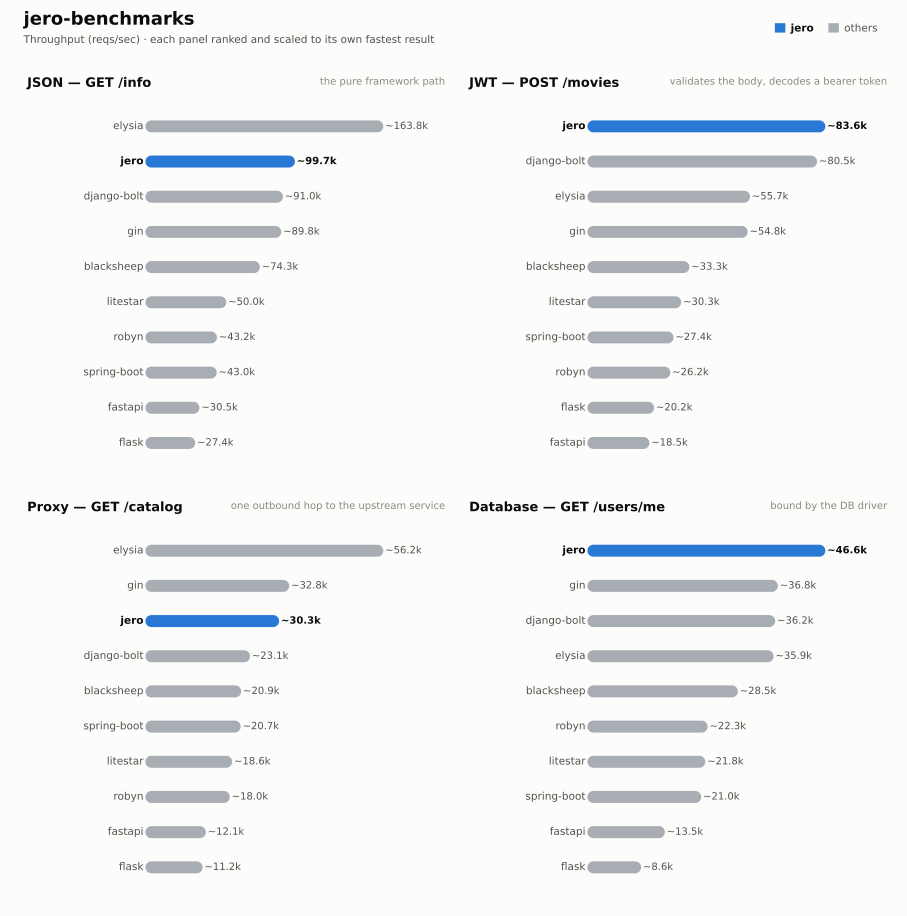

# jero-benchmarks — run `20261028T130318`

_Generated 2026-10-28T13:17:35+00:00_

## Run configuration

| | |
| --- | --- |
| **Run ID** | `20261028T130318` |
| **Created** | 2026-10-28 13:04:11 UTC |
| **Host** | ip-172-31-17-169.eu-central-1.compute.internal |
| **AWS region** | eu-central-1 |
| **EC2 instance type** | c9g.2xlarge |
| **EC2 AMI** | `ami-0f7d895aa37851cb2` |
| **Commit** | [`28f53e21ee18`](https://github.com/RogerThomas/api-benchmarks/commit/28f53e21ee18e3ecd2f5c6f8986e1bd0a17186ff) |
| **Images** | `blacksheep-2026.10.28.01`, `django-bolt-2026.10.28.01`, `elysia-2026.10.28.01`, `fastapi-2026.10.28.01`, `flask-2026.10.28.01`, `gin-2026.10.28.01`, `jero-2026.10.28.01`, `litestar-2026.10.28.01`, `postgres-2026.10.28.01`, `robyn-2026.10.28.01`, `runner-2026.10.28.01`, `spring-boot-2026.10.28.01`, `upstream-2026.10.28.01` |
| **Load generator** | wrk |
| **Connections** | 128 |
| **Duration per attempt** | 60s |
| **Best of** | 3 |
| **Server workers** | 1 |
| **Python server** | peregrine |
| **Event loop** | uvloop |
| **Frameworks** | blacksheep, django-bolt, elysia, fastapi, flask, gin, jero, litestar, robyn, spring-boot |
| **Results backend** | TaglyDB |

## Results

### 1 - GET /info

| Framework | req/s | vs | mean | vs | p99 | vs | succ% | memPk | memAv | cpuAv | cpuPk | cpu ~ | mem ~ |
| --- | --- | --- | --- | --- | --- | --- | --- | --- | --- | --- | --- | --- | --- |
| elysia | ~163.8k | x1.64 | 0.78ms | x1.63 | 1.07ms | x1.23 | 100.00 | 23M | 21M | 100% | 102% | ▇▇▇█▇▇▇▇▇▇▇▇▇▇▇▇ | ▇▇▇▇█▇▇▇▇▇▇▇▇▇▇▇ |
| jero | ~99.7k | x1.00 | 1.27ms | x1.00 | 1.33ms | x1.00 | 100.00 | 43M | 43M | 100% | 102% | ▇▇▇▇▇▇▇▇▇▇▇█▇▇▇▇ | ▇▇▇█▇▇▇▇▇▇▇▇▇▇▇▇ |
| django-bolt | ~91.0k | x0.91 | 1.40ms | x0.91 | 1.44ms | x0.92 | 100.00 | 68M | 68M | 98% | 103% | ▇▇▇█▇▇▇▇▇▇▇▇▇▇▇▄ | █▇▇▇▇▇▇▇▇▇▇▇▇▇▇▇ |
| gin | ~89.8k | x0.90 | 1.43ms | x0.89 | 3.22ms | x0.41 | 100.00 | 10M | 10M | 98% | 102% | ▇▇▇▇█▇▇▇▇▇▇▇▇▇▇▄ | █▇▇▇▇▇▇▇▇▇▇▇▇▇▇▇ |
| blacksheep | ~74.3k | x0.75 | 1.71ms | x0.74 | 1.76ms | x0.75 | 100.00 | 51M | 51M | 97% | 102% | ▇▇▇▇▇▇▇▇▇▇▇▇▇█▇▄ | ▇▇▇█▇▇▇▇▇▇▇▇▇▇▇▇ |
| litestar | ~50.0k | x0.50 | 2.54ms | x0.50 | 2.60ms | x0.51 | 100.00 | 52M | 51M | 100% | 101% | ▇▇█▇▇▇▇▇▇▇▇▇▇▇▇▇ | ▇▇▇█▇▇▇▇▇▇▇▇▇▇▇▇ |
| robyn | ~43.2k | x0.43 | 2.95ms | x0.43 | 3.08ms | x0.43 | 100.00 | 39M | 39M | 97% | 102% | ▆▇▇▇▇▇▇▇▇▇█▇▇▇▇▄ | █▇▇▇▇▇▇▇▇▇▇▇▇▇▇▇ |
| spring-boot | ~43.0k | x0.43 | 2.97ms | x0.43 | 4.71ms | x0.28 | 100.00 | 622M | 621M | 102% | 103% | ▇▇▇█▇▇▇▇▇▇▇▇▇▇▇▇ | ▇█▇▇▇▇▇▇▇▇▇▇▇▇▇▇ |
| fastapi | ~30.5k | x0.31 | 4.17ms | x0.31 | 4.23ms | x0.31 | 100.00 | 57M | 56M | 97% | 101% | ▇▇▇▇█▇▇▇▇▇▇▇▇▇▇▄ | ▇▇▇▇▇█▇▇▇▇▇▇▇▇▇▇ |
| flask | ~27.4k | x0.27 | 4.66ms | x0.27 | 4.77ms | x0.28 | 100.00 | 61M | 61M | 100% | 102% | █▇▇▇▇▇▇▇▇▇▇▇▇▇▇▇ | █▇▇▇▇▇▇▇▇▇▇▇▇▇▇▇ |

### 2 - POST /movies (JWT)

| Framework | req/s | vs | mean | vs | p99 | vs | succ% | memPk | memAv | cpuAv | cpuPk | cpu ~ | mem ~ |
| --- | --- | --- | --- | --- | --- | --- | --- | --- | --- | --- | --- | --- | --- |
| jero | ~83.6k | x1.00 | 1.52ms | x1.00 | 1.57ms | x1.00 | 100.00 | 44M | 43M | 100% | 103% | ▇▇▇▇▇▇▇▇▇▇█▇▇▇▇▇ | ▇▇▇▇▇▇▇█▇▇▇▇▇▇▇▇ |
| django-bolt | ~80.5k | x0.96 | 1.59ms | x0.96 | 1.62ms | x0.97 | 100.00 | 70M | 69M | 101% | 103% | ▇▇█▇▇▇▇▇▇▇▇▇▇▇▇▇ | ▇█▇▇▇▇▇▇▇▇▇▇▇▇▇▇ |
| elysia | ~55.7k | x0.67 | 2.29ms | x0.66 | 3.98ms | x0.40 | 100.00 | 30M | 29M | 100% | 102% | ▇▇█▇▇▇▇▇▇▇▇▇▇▇▇▇ | ▇▇▇▇▇▇▇▇▇▇▇▇▇▇▇█ |
| gin | ~54.8k | x0.66 | 2.34ms | x0.65 | 4.97ms | x0.32 | 100.00 | 10M | 10M | 101% | 102% | ▇▇▇█▇▇▇▇▇▇▇▇▇▇▇▇ | █▇▇▇▇▇▇▇▇▇▇▇▇▇▇▇ |
| blacksheep | ~33.3k | x0.40 | 3.82ms | x0.40 | 3.88ms | x0.41 | 100.00 | 52M | 51M | 97% | 101% | ▇▇▇▇▇▇▇▇▇▇▇▇█▇▇▄ | █▇▇▇▇▇▇▇▇▇▇▇▇▇▇▇ |
| litestar | ~30.3k | x0.36 | 4.22ms | x0.36 | 4.29ms | x0.37 | 100.00 | 52M | 52M | 100% | 101% | ▇▇▇▇▇▇▇█▇▇▇▇▇▇▇▇ | ▇▇▇▇▇▇█▇▇▇▇▇▇▇▇▇ |
| spring-boot | ~27.4k | x0.33 | 4.66ms | x0.33 | 7.17ms | x0.22 | 100.00 | 629M | 629M | 101% | 103% | ▇▇▇▇▇▇▇▇▇▇▇▇▇▇█▇ | ▇▇▇▇▇█▇▇▇▇▇▇▇▇▇▇ |
| robyn | ~26.2k | x0.31 | 4.87ms | x0.31 | 5.89ms | x0.27 | 100.00 | 40M | 39M | 100% | 102% | ▇▇▇▇▇▇▇▇▇▇▇▇▇▇█▇ | ▇▇▇▇▇▇▇▇█▇▇▇▇▇▇▇ |
| flask | ~20.2k | x0.24 | 6.32ms | x0.24 | 6.45ms | x0.24 | 100.00 | 61M | 61M | 100% | 102% | ▇▇▇▇▇█▇▇▇▇▇▇▇▇▇▇ | █████▇▇▇▇▇▇▇▇▇▇▇ |
| fastapi | ~18.5k | x0.22 | 6.91ms | x0.22 | 6.97ms | x0.23 | 100.00 | 57M | 57M | 97% | 101% | ▇▇▇▇▇▇▇▇▇▇▇█▇▇▇▄ | ▇▇▇▇▇▇█▇▇▇▇▇▇▇▇▇ |

### 3 - GET proxy (upstream)

| Framework | req/s | vs | mean | vs | p99 | vs | succ% | memPk | memAv | cpuAv | cpuPk | cpu ~ | mem ~ |
| --- | --- | --- | --- | --- | --- | --- | --- | --- | --- | --- | --- | --- | --- |
| elysia | ~56.2k | x1.86 | 2.27ms | x1.86 | 3.72ms | x1.94 | 100.00 | 28M | 26M | 98% | 102% | ▇▇▇▇▇▇▇▇▇▇▇█▇▇▇▄ | ▇▇▇▇▇▇█▇▇▇▇▇▇▇▇▆ |
| gin | ~32.8k | x1.08 | 3.90ms | x1.08 | 7.15ms | x1.01 | 100.00 | 14M | 14M | 101% | 102% | ▇▇▇▇▇▇▇▇▇█▇▇▇▇▇▇ | ▇▇▇▇▇▇▇▇▇▇▇▇▇▇█▇ |
| jero | ~30.3k | x1.00 | 4.22ms | x1.00 | 7.21ms | x1.00 | 100.00 | 59M | 56M | 97% | 102% | ▇▇█▇▇▇▇▇▇▇▇▇▇▇▇▄ | █▇▇▇▇▇▇▇▇▇▇▇▇▇▇▇ |
| django-bolt | ~23.1k | x0.76 | 5.58ms | x0.76 | 11.88ms | x0.61 | 100.00 | 103M | 96M | 97% | 102% | ▇▇▇▇▇▇▇▇▇█▇▇▇▇▇▄ | ▇█▇▇▇▇▇▇▇▇▇▇▇▇▇▇ |
| blacksheep | ~20.9k | x0.69 | 6.13ms | x0.69 | 11.42ms | x0.63 | 100.00 | 69M | 68M | 101% | 102% | ▇▇▇▇▇▇▇▇█▇▇▇▇▇▇▇ | ▇█▇▇▇▇▇▇▇▇▇▇▇▇▇▇ |
| spring-boot | ~20.7k | x0.68 | 6.16ms | x0.69 | 9.60ms | x0.75 | 100.00 | 664M | 663M | 101% | 103% | ▇▇▇▇▇▇▇▇█▇▇▇▇▇▇▇ | ▇▇▇▇▇▇▇▇▇▇██▇▇▇▇ |
| litestar | ~18.6k | x0.61 | 6.88ms | x0.61 | 14.15ms | x0.51 | 100.00 | 66M | 65M | 101% | 102% | ▇▇▇█▇▇▇▇▇▇▇▇▇▇▇▇ | █▇▇▇▇▇▇▇▇▇▇▇▇▇▇▇ |
| robyn | ~18.0k | x0.59 | 7.10ms | x0.59 | 10.47ms | x0.69 | 100.00 | 62M | 59M | 97% | 101% | ▇▇▇▇▇▇▇▇▇█▇▇▇▇▇▄ | █▇▇▇▇▇▇▇▇▇▇▇▇▇▇▇ |
| fastapi | ~12.1k | x0.40 | 10.61ms | x0.40 | 20.40ms | x0.35 | 100.00 | 74M | 72M | 97% | 102% | ▇▇▇▇▇▇█▇▇▇▇▇▇▇▇▄ | █▇▇▇▇▇▇▇▇▇▇▇▇▇▇▇ |
| flask | ~11.2k | x0.37 | 11.36ms | x0.37 | 11.97ms | x0.60 | 100.00 | 62M | 61M | 90% | 94% | ▇▇▇▇▇▇▇▇▇▇▇▇▇▇█▄ | █▇▇▇▇▇▇▇▇▇▇▇▇▇▇▇ |

### 4 - GET /users/me (DB)

| Framework | req/s | vs | mean | vs | p99 | vs | succ% | memPk | memAv | cpuAv | cpuPk | cpu ~ | mem ~ |
| --- | --- | --- | --- | --- | --- | --- | --- | --- | --- | --- | --- | --- | --- |
| jero | ~46.6k | x1.00 | 2.74ms | x1.00 | 3.37ms | x1.00 | 100.00 | 61M | 60M | 100% | 102% | ▇▇▇▇▇▇▇▇▇▇▇▇▇█▇▇ | ▇▇▇▇▇▇▇▇▇▇▇▇▇▇█▇ |
| gin | ~36.8k | x0.79 | 3.49ms | x0.79 | 7.71ms | x0.44 | 100.00 | 32M | 29M | 101% | 103% | ▇▇▇▇█▇▇▇▇▇▇▇▇▇▇▇ | ▇█▇▇▇▇▇▇▇▇▇▇▇▇▇▇ |
| django-bolt | ~36.2k | x0.78 | 3.52ms | x0.78 | 4.39ms | x0.77 | 100.00 | 101M | 100M | 100% | 102% | ▇▇▇█▇▇▇▇▇▇▇▇▇▇▇▇ | █▇▇▇▇▇▇▇▇▇▇▇▇▇▇▇ |
| elysia | ~35.9k | x0.77 | 3.56ms | x0.77 | 6.80ms | x0.50 | 100.00 | 32M | 31M | 101% | 103% | ▇▇▇▇▇▇▇▇▇▇▇▇▇▇█▇ | ▇▇▇▇▇▇▇▇▇▇▇▇▇█▇▇ |
| blacksheep | ~28.5k | x0.61 | 4.48ms | x0.61 | 5.61ms | x0.60 | 100.00 | 72M | 71M | 100% | 102% | ▇▇▇▇▇▇▇▇▇▇▇█▇▇▇▇ | ▇█▇▇▇▇▇▇▇▇▇▇▇▇▇▇ |
| robyn | ~22.3k | x0.48 | 5.73ms | x0.48 | 8.83ms | x0.38 | 100.00 | 63M | 62M | 101% | 102% | ▇▇▇▇▇▇▇█▇▇▇▇▇▇▇▇ | ▇▇▇█▇▇▇▇▇▇▇▇▇▇▇▇ |
| litestar | ~21.8k | x0.47 | 5.87ms | x0.47 | 8.05ms | x0.42 | 100.00 | 70M | 69M | 101% | 102% | ▇▇▇▇▇▇█▇▇▇▇▇▇▇▇▇ | ▇█▇▇▇▇▇▇▇▇▇▇▇▇▇▇ |
| spring-boot | ~21.0k | x0.45 | 6.09ms | x0.45 | 9.79ms | x0.34 | 100.00 | 675M | 674M | 101% | 103% | ▇▇▇▇▇▇▇▇▇█▇▇▇▇▇▇ | ▇▇▇▇▇▇▇▇▇▇▇▇▇█▇▇ |
| fastapi | ~13.5k | x0.29 | 9.49ms | x0.29 | 19.60ms | x0.17 | 100.00 | 76M | 75M | 100% | 102% | ▇▇▇▇▇▇▇▇▇▇▇▇█▇▇▇ | ▇▇█▇▇▇▇▇▇▇▇▇▇▇▇▇ |
| flask | ~8.6k | x0.18 | 14.86ms | x0.18 | 16.35ms | x0.21 | 100.00 | 61M | 61M | 78% | 78% | ▇▇▇▇▇▇█▇▇▇▇▇▇▇▇▇ | █████████▇▇▇▇▇▇▇ |

## How these results were made

**Isolation.** Exactly one framework container is ever alive at a time, alongside
the shared Postgres/upstream/load-generator infra -- brought up via `compose.base.yml`
plus that framework's own `compose.<fw>.yml`, torn down before the next framework
starts. No two frameworks ever share a core or contend for host resources.

**One worker, one core.** Every service runs exactly 1 worker (peregrine
`--workers 1`, Gin `GOMAXPROCS=1`, Bun's single JS thread, Bolt `--processes 1`),
pinned to one dedicated CPU core via `cpuset` affinity -- not a CFS quota, which
throttles a saturated container every 100ms scheduler period and adds
tail-latency stalls; affinity confines all of a framework's threads (including
GIL-releasing extensions like `msgspec`/`fastpg`) to one core with no such stalls.

**Equal resource budgets.** DB pool and outbound-HTTP pool are capped at **64**
connections for every framework/language.

**Load generator.** wrk (C) or oha (Rust), on two dedicated cores -- fast
enough that the framework, not the load generator, is what saturates.

**Best of N.** Each (framework, test) pair starts with an untimed 3s warm-up,
then runs multiple attempts; the attempt with the highest req/s is kept.

**Success %** is the share of requests that got the expected status. Before
the load, a correctness pass also checks the *body* of 100 responses (key
fields per test); if any is wrong, the whole test is reported as 0% success,
so a fast-but-wrong response can never pass as a success.

**Resource-use columns.** `memPk`/`memAv` = peak/average resident memory (MB);
`cpuAv`/`cpuPk` = average/peak CPU as % of one core (pinned via `cpuset`, so
these sit ≤100%); `cpu ~`/`mem ~` = a 0-to-max-scaled sparkline of the CPU/memory
time series during the attempt. Only the framework's own container is measured
-- Postgres and the upstream are excluded.

**Equal work, per test** -- every framework does the same task; only the
*native* tool differs:

| Framework | Language | Server | HTTP client | DB driver | Validates body (test 2) | Parses upstream (test 3) | JSON serializer |
| --- | --- | --- | --- | --- | --- | --- | --- |
| blacksheep | Python 3.14 | peregrine ASGI | lothc | fastpg | pydantic (FromJSON) | typed (pydantic) | stdlib json (BlackSheep default) |
| django-bolt | Python 3.14 | built-in Rust server | lothc | fastpg | msgspec Struct | typed (msgspec) + response re-validate | msgspec |
| elysia | Bun / TS | Bun native | fetch | Bun SQL | typebox schema | passthrough object | Bun native |
| fastapi | Python 3.14 | peregrine ASGI | lothc | fastpg | pydantic | typed (pydantic) + response-model re-validate | pydantic |
| flask | Python 3.14 | peregrine WSGI | lothc (sync) | psycopg | pydantic | typed (pydantic) | stdlib json |
| gin | Go | net/http (GOMAXPROCS=1) | net/http | pgx | ShouldBindJSON struct | typed struct | encoding/json |
| jero | Python 3.14 | peregrine ASGI | lothc | fastpg | msgspec Struct | typed (msgspec) | msgspec |
| litestar | Python 3.14 | peregrine ASGI | lothc | fastpg | msgspec Struct | typed (msgspec) | msgspec |
| robyn | Python 3.14 | built-in Rust server | lothc | fastpg | pydantic (native param) | typed (pydantic) | orjson (dicts) / pydantic |
| spring-boot | Java 25 | embedded Tomcat, virtual threads | RestClient (Apache HttpClient5) | JdbcTemplate (HikariCP) | jakarta bean validation (record) | typed (Jackson) | Jackson |

**One deliberate exception to per-framework idiom:** Django Bolt
reaches Postgres through raw fastpg -- the same driver the rest of the async
Python fleet uses -- rather than Django's ORM, whose sync-driver-behind-an-async-facade
design would make test 4 a measurement of Django's data layer instead of the
framework. For the same reason, every JWT endpoint hand-decodes the bearer
token with ryjwt rather than using each framework's own auth integration.

**Known, intended differences** (each framework's real idiomatic behaviour, kept
rather than normalised away): the JSON serializer column (stdlib `json` is
slower than msgspec/orjson/native); FastAPI and Django Bolt additionally
re-validate the *response* against its declared model (both frameworks'
default); Elysia returns the upstream payload parsed but unvalidated;
Spring Boot's Jackson binding coerces a numeric field given
as a JSON string rather than rejecting it like pydantic/msgspec do. These are
visible here so a number is never mistaken for pure framework speed.

## Disclosure

The author of this benchmark suite is also the author of [jero](https://pypi.org/project/jero/), one of the frameworks benchmarked here. Every measure above -- equal resource budgets, idiomatic code per framework, isolated single-framework runs, documented intended differences -- applies identically to jero and everyone else; nothing here is tuned in its favor.

---
_Generated by `export_results.py` from `results.is_best` rows in TaglyDB._