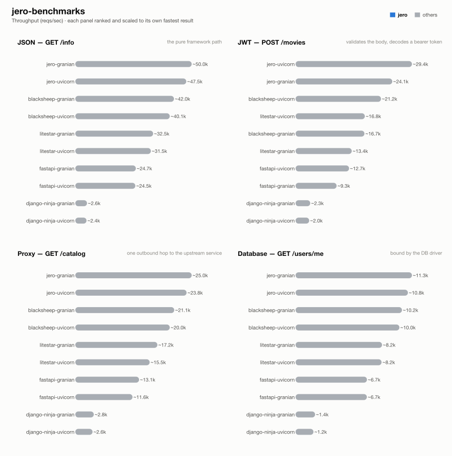

# jero-benchmarks — run `asgi-server-sweep-final`

_Generated 2026-08-16T06:31:18+00:00_

## Run configuration

| | |
| --- | --- |
| **Run ID** | `asgi-server-sweep-final` |
| **Created** | 2026-08-15 20:41:31 UTC |
| **Host** | ip-172-31-21-72.eu-central-1.compute.internal |
| **AWS region** | eu-central-1 |
| **EC2 instance type** | c9g.2xlarge |
| **EC2 AMI** | `ami-0f7d895aa37851cb2` |
| **k6 VUs** | 128 |
| **Duration per attempt** | 60s |
| **Best of** | 3 |
| **Server workers** | 1 |
| **Python server** | granian |
| **Event loop** | uvloop |
| **Frameworks** | blacksheep-granian, blacksheep-uvicorn, django-ninja-granian, django-ninja-uvicorn, fastapi-granian, fastapi-uvicorn, jero-granian, jero-uvicorn, litestar-granian, litestar-uvicorn |

## Results



### 1 - GET /info

| Framework | req/s | vs | mean | vs | p99 | vs | succ% | memPk | memAv | cpuAv | cpuPk | cpu ~ | mem ~ |
| --- | --- | --- | --- | --- | --- | --- | --- | --- | --- | --- | --- | --- | --- |
| jero-granian | ~50.0k | - | 2.51ms | - | 11.02ms | - | 100.00 | 84M | 79M | 90% | 98% | ▄▇▇▇▇▇▇▇▇▇▇▇▇▇█▅ | ▇▇▇▇▇▇▇▇▇▇▇▇▇▇▇█ |
| jero-uvicorn | ~47.5k | - | 2.63ms | - | 12.25ms | - | 100.00 | 61M | 51M | 87% | 96% | ▅▆▇▇▇▇▇▇▇▇▇▇▇█▇▄ | █▆▆▆▆▆▆▆▇▆▆▆▆▆▆▆ |
| blacksheep-granian | ~42.0k | - | 3.00ms | - | 11.52ms | - | 100.00 | 79M | 73M | 93% | 102% | ▇▇▇▇▇▇▇▇▇▇▇▇▇▇█▄ | ▇▇▇▇▇▇▇█▇▇▇▇▇▇▇▇ |
| blacksheep-uvicorn | ~40.1k | - | 3.13ms | - | 12.90ms | - | 100.00 | 62M | 53M | 92% | 99% | ▇▇▇▇▇▇▇▇▇▇▇▇▇▇█▄ | ▇▇▇▇█▇▇▇▇▇▇▇▇▇▇▇ |
| litestar-granian | ~32.5k | - | 3.89ms | - | 12.78ms | - | 100.00 | 81M | 77M | 94% | 101% | ▇▇▇▇▇▇▇▇▇▇▇█▇▇▇▄ | ▇▇▇▇▇▇▇▇▇▇▇▇█▇▇▇ |
| litestar-uvicorn | ~31.5k | - | 3.98ms | - | 13.95ms | - | 100.00 | 63M | 56M | 92% | 99% | ▆▇▇▇▇▇▇▇▇▇▇▇▇▇█▄ | █▇▇▇▇▇▇▇▇▇▇▇▇▇▇▇ |
| fastapi-granian | ~24.7k | - | 5.14ms | - | 14.25ms | - | 100.00 | 75M | 75M | 97% | 102% | ▇▇▇▇▇▇▇▇▇▇▇▇█▇▇▄ | █▇▇▇▇▇▇▇▇▇▇▇▇▇▇▇ |
| fastapi-uvicorn | ~24.5k | - | 5.18ms | - | 15.47ms | - | 100.00 | 65M | 55M | 95% | 101% | ▇▇▇▇▇▇▇▇▇▇▇▇▇▇█▄ | ▇█▇▇▇▇▇▇▇▇▇▇▇▇▇▇ |
| django-ninja-granian | ~2.6k | - | 48.88ms | - | 79.47ms | - | 100.00 | 122M | 113M | 99% | 100% | ▇▇▇▇▇▇▇▇█▇▇▇▇▇▇▇ | ▇▇█▇▇▇▇▇▇▇▇▇▇▇▇▇ |
| django-ninja-uvicorn | ~2.4k | - | 53.65ms | - | 104.69ms | - | 100.00 | 109M | 100M | 96% | 100% | ▇▇▇█▇▇▇▇▇▇▇▇▇▇▇▄ | ▇▇▇▇▇▇█▇▇▇▇▇▇▇▇▇ |

### 2 - POST /movies (JWT)

| Framework | req/s | vs | mean | vs | p99 | vs | succ% | memPk | memAv | cpuAv | cpuPk | cpu ~ | mem ~ |
| --- | --- | --- | --- | --- | --- | --- | --- | --- | --- | --- | --- | --- | --- |
| jero-uvicorn | ~29.4k | - | 4.23ms | - | 15.24ms | - | 100.00 | 61M | 51M | 91% | 98% | ▇▇▇▇▇▇▇▇▇▇▇▇▇▇█▄ | ▇▇▇▇█▇▇▇▇▇▇▇▇▇▇▇ |
| jero-granian | ~24.1k | - | 5.24ms | - | 16.40ms | - | 100.00 | 81M | 81M | 96% | 102% | ▇▇▇▇▇▇▇▇▇▇▇▇█▇▇▄ | ▇▇▇▇▇▇▇▇█▇▇▇▇▇▇▇ |
| blacksheep-uvicorn | ~21.2k | - | 5.97ms | - | 16.80ms | - | 100.00 | 63M | 53M | 95% | 100% | ▇▇▇▇▇▇▇▇█▇▇▇▇▇▇▄ | ▇▇▇▇▇▇▇▇▇▇▇▇▇▇█▇ |
| litestar-uvicorn | ~16.8k | - | 7.54ms | - | 18.50ms | - | 100.00 | 66M | 57M | 96% | 103% | ▇▇▇▇▇▇▇▇▇▇▇▇▇▇█▄ | ▇▇▇▇▇▇▇█▇▇▇▇▇▇▇▇ |
| blacksheep-granian | ~16.7k | - | 7.60ms | - | 18.18ms | - | 100.00 | 75M | 74M | 100% | 103% | ▇▇▇▇▇▇▇▇▇▇▇▇█▇▇▇ | ▇▇▇▇▇▇▇▇▇▇█▇▇▇▇▇ |
| litestar-granian | ~13.4k | - | 9.54ms | - | 20.78ms | - | 100.00 | 84M | 79M | 99% | 101% | ▇▇▇▇▇▇▇▇█▇▇▇▇▇▇▇ | ▇▇▇▇▇▇▇▇▇▇▇▇█▇▇▇ |
| fastapi-uvicorn | ~12.7k | - | 10.07ms | - | 21.69ms | - | 100.00 | 66M | 56M | 101% | 102% | ▇▇▇▇▇█▇▇▇▇▇▇▇▇▇▇ | ▇▇▇█▇▇▇▇▇▇▇▇▇▇▇▇ |
| fastapi-granian | ~9.3k | - | 13.66ms | - | 26.49ms | - | 100.00 | 88M | 78M | 101% | 103% | ▇▇▇▇▇▇▇▇▇█▇▇▇▇▇▇ | ▇▇█▇▇▇▇▇▇▇▇▇▇▇▇▇ |
| django-ninja-granian | ~2.3k | - | 55.04ms | - | 86.28ms | - | 100.00 | 120M | 112M | 96% | 101% | ▇▇▇▇█▇▇▇▇▇▇▇▇▇▇▄ | ▇▇▇▇▇▇▇▇▇▇▇█▇▇▇▇ |
| django-ninja-uvicorn | ~2.0k | - | 62.67ms | - | 121.86ms | - | 100.00 | 111M | 105M | 96% | 101% | ▇▇▇▇▇▇▇█▇▇▇▇▇▇▇▄ | ▇▇▇▇▇█▇▇▇▇▇▇▇▇▇▇ |

### 3 - GET proxy (upstream)

| Framework | req/s | vs | mean | vs | p99 | vs | succ% | memPk | memAv | cpuAv | cpuPk | cpu ~ | mem ~ |
| --- | --- | --- | --- | --- | --- | --- | --- | --- | --- | --- | --- | --- | --- |
| jero-granian | ~25.0k | - | 5.06ms | - | 15.01ms | - | 100.00 | 99M | 97M | 96% | 101% | ▇▇▇▇▇▇▇▇█▇▇▇▇▇▇▄ | ▇▇▇▇▇█▇▇▇▇▇▇▇▇▇▇ |
| jero-uvicorn | ~23.8k | - | 5.30ms | - | 15.02ms | - | 100.00 | 75M | 69M | 95% | 102% | ▇▇▇▇▇▇▇▇▇▇█▇▇▇▇▄ | ▇▇▇▇▇█▇▇▇▇▇▇▇▇▇▇ |
| blacksheep-granian | ~21.1k | - | 6.03ms | - | 15.49ms | - | 100.00 | 94M | 90M | 99% | 101% | ▇█▇▇▇▇▇▇▇▇▇▇▇▇▇▇ | ▇▇▇█▇▇▇▇▇▇▇▇▇▇▇▇ |
| blacksheep-uvicorn | ~20.0k | - | 6.34ms | - | 15.97ms | - | 100.00 | 76M | 67M | 100% | 103% | ▇▇▇▇▇▇▇▇▇▇█▇▇▇▇▇ | █▇▇▇▇▇▇▇▇▇▇▇▇▇▇▇ |
| litestar-granian | ~17.2k | - | 7.39ms | - | 18.47ms | - | 100.00 | 94M | 92M | 98% | 104% | ▇▇▇▇▇▇█▇▇▇▇▇▇▇▇▄ | ▇▇█▇▇▇▇▇▇▇▇▇▇▇▇▇ |
| litestar-uvicorn | ~15.5k | - | 8.22ms | - | 18.89ms | - | 100.00 | 81M | 71M | 100% | 103% | █▇▇▇▇▇▇▇▇▇▇▇▇▇▇▇ | █▇▇▇▇▇▇▇▇▇▇▇▇▇▇▇ |
| fastapi-granian | ~13.1k | - | 9.74ms | - | 22.16ms | - | 100.00 | 101M | 92M | 100% | 103% | ▇▇▇▇▇▇▇▇█▇▇▇▇▇▇▇ | ▇▇█▇▇▇▇▇▇▇▇▇▇▇▇▇ |
| fastapi-uvicorn | ~11.6k | - | 11.00ms | - | 22.82ms | - | 100.00 | 76M | 75M | 101% | 103% | ▇▇█▇▇▇▇▇▇▇▇▇▇▇▇▇ | ▇▇▇▇█▇▇▇▇▇▇▇▇▇▇▇ |
| django-ninja-granian | ~2.8k | - | 45.03ms | - | 77.44ms | - | 100.00 | 138M | 129M | 99% | 101% | ▇▇▇▇▇▇▇▇▇█▇▇▇▇▇▇ | ▇▇▇▇▇▇▇█▇▇▇▇▇▇▇▇ |
| django-ninja-uvicorn | ~2.6k | - | 50.04ms | - | 103.57ms | - | 100.00 | 125M | 117M | 99% | 101% | ▇▇▇▇▇█▇▇▇▇▇▇▇▇▇▇ | ▇▇▇▇▇▇▇▇▇▇▇▇▇█▇▇ |

### 4 - GET /users/me (DB)

| Framework | req/s | vs | mean | vs | p99 | vs | succ% | memPk | memAv | cpuAv | cpuPk | cpu ~ | mem ~ |
| --- | --- | --- | --- | --- | --- | --- | --- | --- | --- | --- | --- | --- | --- |
| jero-granian | ~11.3k | - | 11.33ms | - | 21.25ms | - | 100.00 | 98M | 94M | 101% | 104% | ▇▇▇▇▇▇▇█▇▇▇▇▇▇▇▇ | ▇▇▇█▇▇▇▇▇▇▇▇▇▇▇▇ |
| jero-uvicorn | ~10.8k | - | 11.77ms | - | 23.18ms | - | 100.00 | 79M | 71M | 101% | 104% | ▇▇▇▇▇▇▇▇▇▇▇█▇▇▇▇ | ▇▇█▇▇▇▇▇▇▇▇▇▇▇▇▇ |
| blacksheep-granian | ~10.2k | - | 12.46ms | - | 22.67ms | - | 100.00 | 97M | 89M | 100% | 102% | ▇▇▇█▇▇▇▇▇▇▇▇▇▇▇▇ | ▇▇▇█▇▇▇▇▇▇▇▇▇▇▇▇ |
| blacksheep-uvicorn | ~10.0k | - | 12.77ms | - | 24.44ms | - | 100.00 | 79M | 70M | 98% | 105% | ▇▇▇▇▇▇▇▇▇▇▇▇█▇▇▄ | ▇▇▇▇▇▇▇▇█▇▇▇▇▇▇▇ |
| litestar-granian | ~8.2k | - | 15.54ms | - | 27.98ms | - | 100.00 | 95M | 92M | 100% | 101% | ▇▇▇▇▇▇▇▇█▇▇▇▇▇▇▇ | ▇▇█▇▇▇▇▇▇▇▇▇▇▇▇▇ |
| litestar-uvicorn | ~8.2k | - | 15.64ms | - | 29.80ms | - | 100.00 | 79M | 72M | 101% | 103% | ▇▇▇▇█▇▇▇▇▇▇▇▇▇▇▇ | ▇▇▇▇█▇▇▇▇▇▇▇▇▇▇▇ |
| fastapi-uvicorn | ~6.7k | - | 19.15ms | - | 37.09ms | - | 100.00 | 85M | 75M | 100% | 103% | ▇▇▇▇▇▇▇▇▇▇▇▇▇▇█▇ | ▇█▇▇▇▇▇▇▇▇▇▇▇▇▇▇ |
| fastapi-granian | ~6.7k | - | 19.18ms | - | 34.85ms | - | 100.00 | 97M | 89M | 100% | 103% | ▇█▇▇▇▇▇▇▇▇▇▇▇▇▇▇ | ▇▇▇▇▇▇▇▇▇▇█▇▇▇▇▇ |
| django-ninja-granian | ~1.4k | - | 92.47ms | - | 142.42ms | - | 100.00 | 140M | 132M | 100% | 101% | ▇▇▇▇█▇▇▇▇▇▇▇▇▇▇▇ | ▇▇▇▇▇█▇▇▇▇▇▇▇▇▇▇ |
| django-ninja-uvicorn | ~1.2k | - | 105.00ms | - | 183.46ms | - | 100.00 | 125M | 116M | 96% | 101% | ▇▇▇▇▇▇█▇▇▇▇▇▇▇▇▄ | ▇▇▇▇█▇▇▇▇▇▇▇▇▇▇▇ |

## How these results were made

**Isolation.** Exactly one framework container is ever alive at a time, alongside
the shared Postgres/upstream/k6-runner infra -- brought up via `compose.base.yml`
plus that framework's own `compose.<fw>.yml`, torn down before the next framework
starts. No two frameworks ever share a core or contend for host resources.

**One worker, one core.** Every service runs exactly 1 worker (granian
`--workers 1`, Gin `GOMAXPROCS=1`, Bun's single JS thread, Bolt `--processes 1`),
pinned to one dedicated CPU core via `cpuset` affinity -- not a CFS quota, which
throttles a saturated container every 100ms scheduler period and adds
tail-latency stalls; affinity confines all of a framework's threads (including
GIL-releasing extensions like `msgspec`/`psqlpy`) to one core with no such stalls.

**Equal resource budgets.** DB pool and outbound-HTTP pool are capped at **64**
connections for every framework/language.

**Best of N.** Each (framework, test) pair runs multiple attempts; the
best-scoring attempt is kept. Score equally weights throughput and latency,
each normalized against that test's best attempt:

```
score = reqsPerSec/maxReqs + minMean/mean + minP99/p99
```

**Resource-use columns.** `memPk`/`memAv` = peak/average resident memory (MB);
`cpuAv`/`cpuPk` = average/peak CPU as % of one core (pinned via `cpuset`, so
these sit ≤100%); `cpu ~`/`mem ~` = a 0-to-max-scaled sparkline of the CPU/memory
time series during the attempt. Only the framework's own container is measured
-- Postgres and the upstream are excluded.

**Equal work, per test** -- every framework does the same task; only the
*native* tool differs:


**Known, intended differences** (each framework's real idiomatic behaviour, kept
rather than normalised away): the JSON serializer column (stdlib `json` is
slower than msgspec/orjson/native); FastAPI additionally re-validates the
*response* against its `response_model`; Blacksheep/Elysia/Django Ninja/Django
Bolt return the upstream payload straight through as bytes/dict; the two Django
frameworks return snake_case field names where the rest of the Python fleet
returns camelCase; Spring Boot's Jackson binding coerces a numeric field given
as a JSON string rather than rejecting it like pydantic/msgspec do. These are
visible here so a number is never mistaken for pure framework speed.

## Disclosure

The author of this benchmark suite is also the author of [jero](https://pypi.org/project/jero/), one of the frameworks benchmarked here. Every measure above -- equal resource budgets, idiomatic code per framework, isolated single-framework runs, documented intended differences -- applies identically to jero and everyone else; nothing here is tuned in its favor.

---
_Generated by `export_results.py` from `results.is_best` rows._