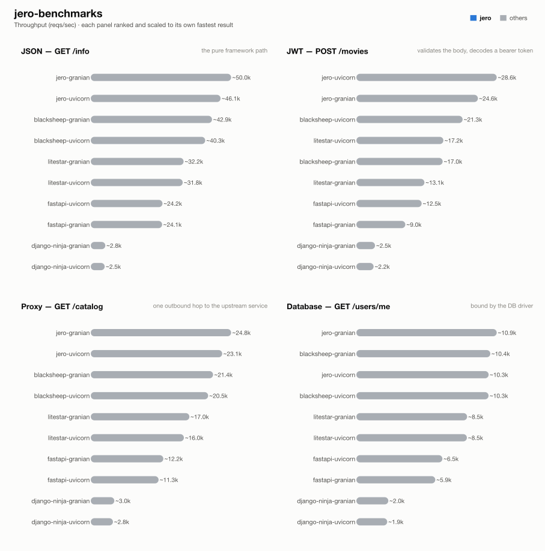

# jero-benchmarks — run `asgi-server-sweep-tuned`

_Generated 2026-08-17T11:50:21+00:00_

## Run configuration

| | |
| --- | --- |
| **Run ID** | `asgi-server-sweep-tuned` |
| **Created** | 2026-08-17 09:41:00 UTC |
| **Host** | ip-172-31-20-135.eu-central-1.compute.internal |
| **AWS region** | eu-central-1 |
| **EC2 instance type** | c9g.2xlarge |
| **EC2 AMI** | `ami-0f7d895aa37851cb2` |
| **k6 VUs** | 128 |
| **Duration per attempt** | 60s |
| **Best of** | 3 |
| **Server workers** | 1 |
| **Python server** | granian |
| **Event loop** | uvloop |
| **Frameworks** | blacksheep-granian, blacksheep-uvicorn, django-ninja-granian, django-ninja-uvicorn, fastapi-granian, fastapi-uvicorn, jero-granian, jero-uvicorn, litestar-granian, litestar-uvicorn |

## Results

### 1 - GET /info

| Framework | req/s | vs | mean | vs | p99 | vs | succ% | memPk | memAv | cpuAv | cpuPk | cpu ~ | mem ~ |
| --- | --- | --- | --- | --- | --- | --- | --- | --- | --- | --- | --- | --- | --- |
| jero-granian | ~50.0k | - | 2.51ms | - | 11.04ms | - | 100.00 | 88M | 80M | 90% | 97% | ▆▇▇▇▇▇▇▇▇▇▇▇█▇▇▄ | ▇▇▇▇▇▇▇▇▇█▇▇▇▇▇▇ |
| jero-uvicorn | ~46.1k | - | 2.71ms | - | 12.61ms | - | 100.00 | 58M | 51M | 86% | 96% | ▅▆▆▇▇▇▇▇▇▇▇▇█▇▇▄ | █▇▇▇▇▇▇▇▇▇▇▇▇▇▇▇ |
| blacksheep-granian | ~42.9k | - | 2.94ms | - | 11.42ms | - | 100.00 | 80M | 73M | 92% | 99% | ▇▇▇▇▇▇▇▇▇▇▇▇▇█▇▄ | ▇▇▇▇▇█▇▇▇▇▇▇▇▇▇▇ |
| blacksheep-uvicorn | ~40.3k | - | 3.11ms | - | 12.87ms | - | 100.00 | 59M | 52M | 92% | 99% | ▆▇▇▇▇▇▇▇▇▇▇▇▇█▇▄ | █▇▇▇▇▇▇▇▇▇▇▇▇▇▇▇ |
| litestar-granian | ~32.2k | - | 3.93ms | - | 13.21ms | - | 100.00 | 87M | 77M | 94% | 100% | ▇▇▇▇▇▇▇▇▇▇▇▇█▇▇▄ | ▇▇▇▇▇▇▇▇▇█▇▇▇▇▇▇ |
| litestar-uvicorn | ~31.8k | - | 3.95ms | - | 13.81ms | - | 100.00 | 59M | 56M | 94% | 101% | ▆▇▇▇▇▇▇▇▇▇▇▇▇▇█▄ | █▇▇▇▇▇▇▇▇▇▇▇▇▇▇▇ |
| fastapi-uvicorn | ~24.2k | - | 5.24ms | - | 15.62ms | - | 100.00 | 56M | 55M | 95% | 100% | ▇▇▇▇▇▇▇▇▇▇█▇▇▇▇▄ | ▇▇█▇▇▇▇▇▇▇▇▇▇▇▇▇ |
| fastapi-granian | ~24.1k | - | 5.27ms | - | 15.09ms | - | 100.00 | 84M | 75M | 97% | 102% | ▇▇▇▇▇▇▇▇▇▇▇▇█▇▇▄ | █▇▇▇▇▇▇▇▇▇▇▇▇▇▇▇ |
| django-ninja-granian | ~2.8k | - | 46.30ms | - | 74.76ms | - | 100.00 | 125M | 114M | 95% | 100% | ▆▇▇▇▇▇▇▇▇▇█▇▇▇▇▄ | ▇▇▇▇▇▇█▇▇▇▇▇▇▇▇▇ |
| django-ninja-uvicorn | ~2.5k | - | 50.69ms | - | 95.74ms | - | 100.00 | 110M | 102M | 96% | 101% | ▇▇▇▇▇█▇▇▇▇▇▇▇▇▇▄ | ▇▇▇▇▇▇█▇▇▇▇▇▇▇▇▇ |

### 2 - POST /movies (JWT)

| Framework | req/s | vs | mean | vs | p99 | vs | succ% | memPk | memAv | cpuAv | cpuPk | cpu ~ | mem ~ |
| --- | --- | --- | --- | --- | --- | --- | --- | --- | --- | --- | --- | --- | --- |
| jero-uvicorn | ~28.6k | - | 4.32ms | - | 15.67ms | - | 100.00 | 61M | 51M | 91% | 98% | ▇▇▇▇▇▇▇▇▇▇▇▇▇█▇▄ | ▇▇▇▇▇▇▇▇▇▇▇▇▇█▇▇ |
| jero-granian | ~24.6k | - | 5.14ms | - | 16.29ms | - | 100.00 | 82M | 80M | 96% | 102% | ▇▇▇▇▇▇▇▇▇▇▇▇▇▇█▄ | ▇▇▇▇▇▇▇▇▇█▇▇▇▇▇▇ |
| blacksheep-uvicorn | ~21.3k | - | 5.93ms | - | 16.69ms | - | 100.00 | 64M | 53M | 98% | 102% | ▇▇▇▇▇▇▇█▇▇▇▇▇▇▇▇ | ▇▇▇▇▇▇▇▇▇▇█▇▇▇▇▇ |
| litestar-uvicorn | ~17.2k | - | 7.40ms | - | 18.15ms | - | 100.00 | 67M | 57M | 99% | 101% | ▇█▇▇▇▇▇▇▇▇▇▇▇▇▇▇ | ▆▆▆▆▆▆▆▆█▆▆▆▆▆▆▆ |
| blacksheep-granian | ~17.0k | - | 7.48ms | - | 17.97ms | - | 100.00 | 83M | 75M | 101% | 103% | ▇▇▇▇▇█▇▇▇▇▇▇▇▇▇▇ | ▇▇▇▇▇▇▇▇▇▇█▇▇▇▇▇ |
| litestar-granian | ~13.1k | - | 9.74ms | - | 21.05ms | - | 100.00 | 90M | 79M | 100% | 102% | ▇▇▇▇▇▇█▇▇▇▇▇▇▇▇▇ | ▇▇▇▇▇▇▇▇▇▇▇▇▇▇▇█ |
| fastapi-uvicorn | ~12.5k | - | 10.20ms | - | 21.94ms | - | 100.00 | 65M | 55M | 97% | 103% | ▇▇▇▇█▇▇▇▇▇▇▇▇▇▇▄ | ▇▇▇▇▇▇▇▇▇▇▇█▇▇▇▇ |
| fastapi-granian | ~9.0k | - | 14.22ms | - | 28.98ms | - | 100.00 | 78M | 77M | 98% | 102% | ▇▇▇▇▇█▇▇▇▇▇▇▇▇▇▄ | ▇▇▇▇▇▇▇▇▇█▇▇▇▇▇▇ |
| django-ninja-granian | ~2.5k | - | 51.91ms | - | 86.13ms | - | 100.00 | 125M | 116M | 99% | 100% | ▇█▇▇▇▇▇▇▇▇▇▇▇▇▇▇ | ▇▇▇▇▇▇▇▇▇▇▇▇▇▇█▇ |
| django-ninja-uvicorn | ~2.2k | - | 59.20ms | - | 111.97ms | - | 100.00 | 117M | 109M | 97% | 101% | █▇▇▇▇▇▇▇▇▇▇▇▇▇▇▄ | ▇█▇▇▇▇▇▇▇▇▇▇▇▇▇▇ |

### 3 - GET proxy (upstream)

| Framework | req/s | vs | mean | vs | p99 | vs | succ% | memPk | memAv | cpuAv | cpuPk | cpu ~ | mem ~ |
| --- | --- | --- | --- | --- | --- | --- | --- | --- | --- | --- | --- | --- | --- |
| jero-granian | ~24.8k | - | 5.11ms | - | 14.92ms | - | 100.00 | 109M | 101M | 97% | 102% | ▇▇▇▇▇▇▇▇▇▇▇█▇▇▇▄ | ▇▇▇▇▇▇▇▇▇▇▇█▇▇▇▇ |
| jero-uvicorn | ~23.1k | - | 5.48ms | - | 15.61ms | - | 100.00 | 81M | 70M | 99% | 102% | ▇▇▇▇▇▇▇▇█▇▇▇▇▇▇▇ | ▇▇▇▇▇▇▇▇▇▇▇▇█▇▇▇ |
| blacksheep-granian | ~21.4k | - | 5.93ms | - | 15.23ms | - | 100.00 | 96M | 88M | 98% | 103% | ▇▇▇▇▇▇█▇▇▇▇█▇▇▇▄ | ▇▇▇▇▇▇▇▇▇▇▇▇▇▇█▇ |
| blacksheep-uvicorn | ~20.5k | - | 6.20ms | - | 15.47ms | - | 100.00 | 69M | 64M | 96% | 102% | █▇▇▇▇▇▇▇▇▇▇▇▇▇▇▄ | ▇▇▇▇▇▇▇▇▇▇█▇▇▇▇▇ |
| litestar-granian | ~17.0k | - | 7.49ms | - | 18.65ms | - | 100.00 | 107M | 99M | 96% | 101% | █▇▇▇▇▇▇▇▇▇▇▇▇▇▇▄ | ▇▇▇▇█▇▇▇▇▇▇▇▇▇▇▇ |
| litestar-uvicorn | ~16.0k | - | 7.97ms | - | 17.65ms | - | 100.00 | 78M | 68M | 97% | 102% | ▇▇▇▇▇▇█▇▇▇▇▇▇▇▇▄ | ▇▇▇▇▇▇▇▇█▇▇▇▇▇▇▇ |
| fastapi-granian | ~12.2k | - | 10.47ms | - | 24.74ms | - | 100.00 | 91M | 88M | 101% | 104% | ▇▇▇▇▇▇▇▇█▇▇▇▇▇▇▇ | ▇▇▇▇▇▇▇▇█▇▇▇▇▇▇▇ |
| fastapi-uvicorn | ~11.3k | - | 11.30ms | - | 25.07ms | - | 100.00 | 78M | 71M | 100% | 101% | ▇▇▇▇▇▇▇▇▇▇▇▇▇▇█▇ | ▇▇▇▇▇▇▇▇▇▇▇▇▇█▇▇ |
| django-ninja-granian | ~3.0k | - | 41.97ms | - | 72.38ms | - | 100.00 | 143M | 136M | 99% | 100% | ▇▇▇▇▇▇▇▇▇▇▇▇█▇▇▇ | ▇▇▇▇▇▇▇▇▇▇▇█▇▇▇▇ |
| django-ninja-uvicorn | ~2.8k | - | 45.90ms | - | 89.43ms | - | 100.00 | 128M | 117M | 99% | 101% | ▇▇▇▇▇▇▇▇▇▇▇▇▇▇█▇ | ▇▇▇▇▇▇█▇▇▇▇▇▇▇▇▇ |

### 4 - GET /users/me (DB)

| Framework | req/s | vs | mean | vs | p99 | vs | succ% | memPk | memAv | cpuAv | cpuPk | cpu ~ | mem ~ |
| --- | --- | --- | --- | --- | --- | --- | --- | --- | --- | --- | --- | --- | --- |
| jero-granian | ~10.9k | - | 11.66ms | - | 22.02ms | - | 100.00 | 104M | 99M | 99% | 102% | █▇▇▇▇▇▇▇▇▇▇▇▇▇▇▇ | ▇▇▇█▇▇▇▇▇▇▇▇▇▇▇▇ |
| blacksheep-granian | ~10.4k | - | 12.26ms | - | 22.26ms | - | 100.00 | 98M | 91M | 99% | 101% | ▇▇▇▇▇▇▇▇▇▇▇▇▇▇█▇ | ▇▇▇▇▇▇█▇▇▇▇▇▇▇▇▇ |
| jero-uvicorn | ~10.3k | - | 12.40ms | - | 24.32ms | - | 100.00 | 83M | 71M | 100% | 102% | ▇▇▇▇▇▇▇█▇▇▇▇▇▇▇▇ | ▇▇█▇▇▇▇▇▇▇▇▇▇▇▇▇ |
| blacksheep-uvicorn | ~10.3k | - | 12.41ms | - | 23.07ms | - | 100.00 | 68M | 66M | 98% | 104% | ▇▇▇▇▇▇▇▇▇▇▇█▇▇▇▄ | ▇▇▇▇▇▇▇▇▇▇▇▇▇▇█▇ |
| litestar-granian | ~8.5k | - | 15.01ms | - | 26.91ms | - | 100.00 | 102M | 98M | 101% | 103% | █▇▇▇▇▇▇▇▇▇▇▇▇▇▇▇ | ▇▇▇▇▇█▇▇▇▇▇▇▇▇▇▇ |
| litestar-uvicorn | ~8.5k | - | 15.04ms | - | 28.18ms | - | 100.00 | 78M | 70M | 97% | 104% | █▇▇▇▇▇▇▇▇▇▇▇▇▇▇▄ | ▇▇▇▇▇█▇▇▇▇▇▇▇▇▇▇ |
| fastapi-uvicorn | ~6.5k | - | 19.72ms | - | 38.50ms | - | 100.00 | 82M | 74M | 97% | 102% | ▇▇▇▇▇▇▇▇▇▇▇█▇▇▇▄ | ▇▇▇▇▇▇▇▇▇▇▇▇▇█▇▇ |
| fastapi-granian | ~5.9k | - | 21.67ms | - | 41.33ms | - | 100.00 | 100M | 89M | 101% | 102% | ▇▇▇▇▇▇▇▇█▇▇▇▇▇▇▇ | ▇▇▇▇▇▇▇▇▇█▇▇▇▇▇▇ |
| django-ninja-granian | ~2.0k | - | 62.77ms | - | 102.82ms | - | 100.00 | 149M | 140M | 99% | 101% | ▇▇▇▇▇▇▇▇█▇▇▇▇▇▇▇ | ▇▇▇▇▇▇▇▇▇▇█▇▇▇▇▇ |
| django-ninja-uvicorn | ~1.9k | - | 65.75ms | - | 114.95ms | - | 100.00 | 118M | 117M | 100% | 102% | ▇▇▇▇▇▇▇▇█▇▇▇▇▇▇▇ | █▇▇▇▇▇▇▇▇▇▇▇▇▇▇▇ |

## How these results were made

**Isolation.** Exactly one framework container is ever alive at a time, alongside
the shared Postgres/upstream/k6-runner infra -- brought up via `compose.base.yml`
plus that framework's own `compose.<fw>.yml`, torn down before the next framework
starts. No two frameworks ever share a core or contend for host resources.

**One worker, one core.** Every service runs exactly 1 worker (granian
`--workers 1`, Gin `GOMAXPROCS=1`, Bun's single JS thread, Bolt `--processes 1`),
pinned to one dedicated CPU core via `cpuset` affinity -- not a CFS quota, which
throttles a saturated container every 100ms scheduler period and adds
tail-latency stalls; affinity confines all of a framework's threads (including
GIL-releasing extensions like `msgspec`/`psqlpy`) to one core with no such stalls.

**Equal resource budgets.** DB pool and outbound-HTTP pool are capped at **64**
connections for every framework/language.

**Best of N.** Each (framework, test) pair runs multiple attempts; the
attempt with the highest req/s is kept.

**Resource-use columns.** `memPk`/`memAv` = peak/average resident memory (MB);
`cpuAv`/`cpuPk` = average/peak CPU as % of one core (pinned via `cpuset`, so
these sit ≤100%); `cpu ~`/`mem ~` = a 0-to-max-scaled sparkline of the CPU/memory
time series during the attempt. Only the framework's own container is measured
-- Postgres and the upstream are excluded.

**Equal work, per test** -- every framework does the same task; only the
*native* tool differs:

**Known, intended differences** (each framework's real idiomatic behaviour, kept
rather than normalised away): the JSON serializer column (stdlib `json` is
slower than msgspec/orjson/native); FastAPI additionally re-validates the
*response* against its `response_model`; Blacksheep/Elysia/Django Ninja/Django
Bolt return the upstream payload straight through as bytes/dict; the two Django
frameworks return snake_case field names where the rest of the Python fleet
returns camelCase; Spring Boot's Jackson binding coerces a numeric field given
as a JSON string rather than rejecting it like pydantic/msgspec do. These are
visible here so a number is never mistaken for pure framework speed.

## Disclosure

The author of this benchmark suite is also the author of [jero](https://pypi.org/project/jero/), one of the frameworks benchmarked here. Every measure above -- equal resource budgets, idiomatic code per framework, isolated single-framework runs, documented intended differences -- applies identically to jero and everyone else; nothing here is tuned in its favor.

---
_Generated by `export_results.py` from `results.is_best` rows._