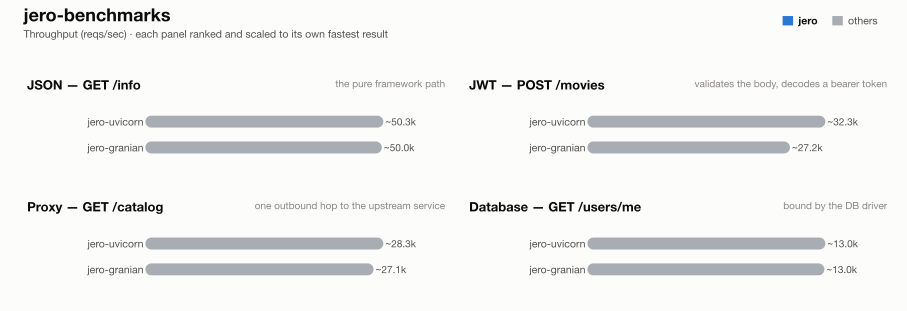

# jero-benchmarks — run `jwt-vs-body-diagnostic`

_Generated 2026-08-16T06:42:38+00:00_

## Run configuration

| | |
| --- | --- |
| **Run ID** | `jwt-vs-body-diagnostic` |
| **Created** | 2026-08-16 06:38:21 UTC |
| **Host** | NITRO-GY7N7RYTHK |
| **AWS region** | -- (not run on EC2) |
| **EC2 instance type** | -- |
| **EC2 AMI** | -- |
| **k6 VUs** | 128 |
| **Duration per attempt** | 10s |
| **Best of** | 2 |
| **Server workers** | 1 |
| **Python server** | granian |
| **Event loop** | uvloop |
| **Frameworks** | jero-granian, jero-uvicorn |

## Results



### 1 - GET /info

| Framework | req/s | vs | mean | vs | p99 | vs | succ% | memPk | memAv | cpuAv | cpuPk | cpu ~ | mem ~ |
| --- | --- | --- | --- | --- | --- | --- | --- | --- | --- | --- | --- | --- | --- |
| jero-uvicorn | ~50.3k | - | 2.46ms | - | 11.96ms | - | 100.00 | 60M | 51M | 71% | 88% | ▇▇▇▇▇▇▇▇███▇▇▇▁▁ | ▆▆▆███▆▆▆▆▆▆▆▆▆▆ |
| jero-granian | ~50.0k | - | 2.48ms | - | 12.30ms | - | 100.00 | 78M | 77M | 89% | 92% | ▇▇▇▇▇▇▇▇▇▇███▇▇▇ | ████▇▇▇▇▇▇▇▇▇▇▇▇ |

### 2 - POST /movies (JWT)

| Framework | req/s | vs | mean | vs | p99 | vs | succ% | memPk | memAv | cpuAv | cpuPk | cpu ~ | mem ~ |
| --- | --- | --- | --- | --- | --- | --- | --- | --- | --- | --- | --- | --- | --- |
| jero-uvicorn | ~32.3k | - | 3.85ms | - | 13.99ms | - | 100.00 | 50M | 50M | 93% | 94% | ▇▇▇▇▇▇▇▇▇▇███▇▇▇ | ▇▇▇▇███▇▇▇▇▇▇▇▇▇ |
| jero-granian | ~27.2k | - | 4.62ms | - | 14.47ms | - | 100.00 | 88M | 81M | 97% | 98% | ████▇▇▇▇▇▇▇▇▇▇▇▇ | ████▇▇▇▇▇▇▇▇▇▇▇▇ |

### 3 - GET proxy (upstream)

| Framework | req/s | vs | mean | vs | p99 | vs | succ% | memPk | memAv | cpuAv | cpuPk | cpu ~ | mem ~ |
| --- | --- | --- | --- | --- | --- | --- | --- | --- | --- | --- | --- | --- | --- |
| jero-uvicorn | ~28.3k | - | 4.45ms | - | 13.41ms | - | 100.00 | 65M | 64M | 97% | 98% | ▇▇▇▇▇▇▇███▇▇▇▇▇▇ | ▇▇▇▇███▇▇▇▇▇▇▇▇▇ |
| jero-granian | ~27.1k | - | 4.65ms | - | 14.23ms | - | 100.00 | 101M | 101M | 98% | 99% | ▇▇▇▇▇▇▇▇▇▇▇▇▇███ | ▇▇▇▇▇▇▇███▇▇▇▇▇▇ |

### 4 - GET /users/me (DB)

| Framework | req/s | vs | mean | vs | p99 | vs | succ% | memPk | memAv | cpuAv | cpuPk | cpu ~ | mem ~ |
| --- | --- | --- | --- | --- | --- | --- | --- | --- | --- | --- | --- | --- | --- |
| jero-uvicorn | ~13.0k | - | 9.75ms | - | 19.40ms | - | 100.00 | 69M | 69M | 83% | 100% | ███▇▇▇▇▇▇▇▇▇▇▇▁▁ | ▇▇▇▇▇▇▇▇▇▇▇███▇▇ |
| jero-granian | ~13.0k | - | 9.80ms | - | 17.84ms | - | 100.00 | 98M | 97M | 83% | 99% | ▇▇▇▇▇▇██▇▇▇▇▇▇▁▁ | ███▇▇▇▇▇▇▇▇▇▇▇▇▇ |

### 5 - POST /echo (body only, no JWT -- diagnostic, jero only)

| Framework | req/s | vs | mean | vs | p99 | vs | succ% | memPk | memAv | cpuAv | cpuPk | cpu ~ | mem ~ |
| --- | --- | --- | --- | --- | --- | --- | --- | --- | --- | --- | --- | --- | --- |
| jero-uvicorn | ~48.0k | - | 2.55ms | - | 12.79ms | - | 100.00 | 67M | 67M | 68% | 85% | ▇▇▇▇▇▇▇▇▇▇▇███▁▁ | ███▇▇▇▇▇▇▇▇▇▇▇▇▇ |
| jero-granian | ~36.4k | - | 3.43ms | - | 13.56ms | - | 100.00 | 98M | 98M | 94% | 95% | ▇▇▇▇▇▇▇███▇▇▇▇▇▇ | ▇▇▇▇▇▇▇▇▇▇▇▇▇███ |

## How these results were made

**Isolation.** Exactly one framework container is ever alive at a time, alongside
the shared Postgres/upstream/k6-runner infra -- brought up via `compose.base.yml`
plus that framework's own `compose.<fw>.yml`, torn down before the next framework
starts. No two frameworks ever share a core or contend for host resources.

**One worker, one core.** Every service runs exactly 1 worker (granian
`--workers 1`, Gin `GOMAXPROCS=1`, Bun's single JS thread, Bolt `--processes 1`),
pinned to one dedicated CPU core via `cpuset` affinity -- not a CFS quota, which
throttles a saturated container every 100ms scheduler period and adds
tail-latency stalls; affinity confines all of a framework's threads (including
GIL-releasing extensions like `msgspec`/`psqlpy`) to one core with no such stalls.

**Equal resource budgets.** DB pool and outbound-HTTP pool are capped at **64**
connections for every framework/language.

**Best of N.** Each (framework, test) pair runs multiple attempts; the
best-scoring attempt is kept. Score equally weights throughput and latency,
each normalized against that test's best attempt:

```
score = reqsPerSec/maxReqs + minMean/mean + minP99/p99
```

**Resource-use columns.** `memPk`/`memAv` = peak/average resident memory (MB);
`cpuAv`/`cpuPk` = average/peak CPU as % of one core (pinned via `cpuset`, so
these sit ≤100%); `cpu ~`/`mem ~` = a 0-to-max-scaled sparkline of the CPU/memory
time series during the attempt. Only the framework's own container is measured
-- Postgres and the upstream are excluded.

**Equal work, per test** -- every framework does the same task; only the
*native* tool differs:


**Known, intended differences** (each framework's real idiomatic behaviour, kept
rather than normalised away): the JSON serializer column (stdlib `json` is
slower than msgspec/orjson/native); FastAPI additionally re-validates the
*response* against its `response_model`; Blacksheep/Elysia/Django Ninja/Django
Bolt return the upstream payload straight through as bytes/dict; the two Django
frameworks return snake_case field names where the rest of the Python fleet
returns camelCase; Spring Boot's Jackson binding coerces a numeric field given
as a JSON string rather than rejecting it like pydantic/msgspec do. These are
visible here so a number is never mistaken for pure framework speed.

## Disclosure

The author of this benchmark suite is also the author of [jero](https://pypi.org/project/jero/), one of the frameworks benchmarked here. Every measure above -- equal resource budgets, idiomatic code per framework, isolated single-framework runs, documented intended differences -- applies identically to jero and everyone else; nothing here is tuned in its favor.

---
_Generated by `export_results.py` from `results.is_best` rows._