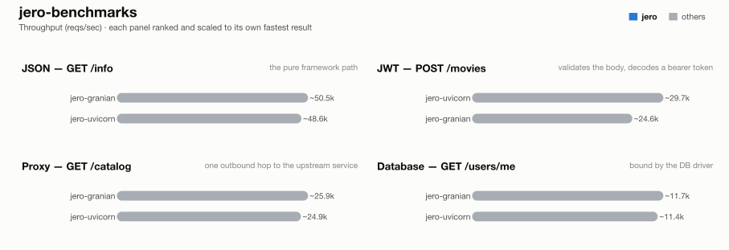

# jero-benchmarks — run `post-upgrade-ec2-verify`

_Generated 2026-08-16T07:54:33+00:00_

## Run configuration

| | |
| --- | --- |
| **Run ID** | `post-upgrade-ec2-verify` |
| **Created** | 2026-08-16 07:15:57 UTC |
| **Host** | ip-172-31-31-87.eu-central-1.compute.internal |
| **AWS region** | eu-central-1 |
| **EC2 instance type** | c9g.2xlarge |
| **EC2 AMI** | `ami-0f7d895aa37851cb2` |
| **k6 VUs** | 128 |
| **Duration per attempt** | 60s |
| **Best of** | 3 |
| **Server workers** | 1 |
| **Python server** | granian |
| **Event loop** | uvloop |
| **Frameworks** | jero-granian, jero-uvicorn |

## Results



### 1 - GET /info

| Framework | req/s | vs | mean | vs | p99 | vs | succ% | memPk | memAv | cpuAv | cpuPk | cpu ~ | mem ~ |
| --- | --- | --- | --- | --- | --- | --- | --- | --- | --- | --- | --- | --- | --- |
| jero-granian | ~50.5k | - | 2.48ms | - | 10.79ms | - | 100.00 | 80M | 78M | 83% | 99% | ▁▄▇▇▇▇▇▇▇▇▇▇▇▇█▅ | ▇▇▇▇▇▇▇▇█▇▇▇▇▇▇▇ |
| jero-uvicorn | ~48.6k | - | 2.58ms | - | 11.87ms | - | 100.00 | 56M | 51M | 89% | 97% | ▆▇▇▇▇▇▇▇▇▇▇▇▇▇█▄ | ▇▇▇▇▇▇▇▇▇█▇▇▇▇▇▇ |

### 2 - POST /movies (JWT)

| Framework | req/s | vs | mean | vs | p99 | vs | succ% | memPk | memAv | cpuAv | cpuPk | cpu ~ | mem ~ |
| --- | --- | --- | --- | --- | --- | --- | --- | --- | --- | --- | --- | --- | --- |
| jero-uvicorn | ~29.7k | - | 4.17ms | - | 14.68ms | - | 100.00 | 57M | 51M | 92% | 100% | ▇▇▇▇▇▇▇▇▇▇▇█▇▇▇▄ | ▇▇▇▇▇█▇▇▇▇▇▇▇▇▇▇ |
| jero-granian | ~24.6k | - | 5.13ms | - | 15.66ms | - | 100.00 | 86M | 81M | 96% | 102% | ▇▇▇▇▇█▇▇▇▇▇▇▇▇▇▄ | ▇▇▇▇█▇▇▇▇▇▇▇▇▇▇▇ |

### 3 - GET proxy (upstream)

| Framework | req/s | vs | mean | vs | p99 | vs | succ% | memPk | memAv | cpuAv | cpuPk | cpu ~ | mem ~ |
| --- | --- | --- | --- | --- | --- | --- | --- | --- | --- | --- | --- | --- | --- |
| jero-granian | ~25.9k | - | 4.87ms | - | 13.80ms | - | 100.00 | 96M | 94M | 96% | 101% | ▇▇▇▇▇▇▇▇▇▇▇▇█▇▇▄ | ▇▇▇▇▇▇▇▇▇▇▇▇▇█▇▇ |
| jero-uvicorn | ~24.9k | - | 5.08ms | - | 14.14ms | - | 100.00 | 75M | 66M | 95% | 102% | ▇▇▇▇▇▇▇▇▇▇▇▇█▇▇▄ | ▇▇▇▇▇▇▇▇█▇▇▇▇▇▇▇ |

### 4 - GET /users/me (DB)

| Framework | req/s | vs | mean | vs | p99 | vs | succ% | memPk | memAv | cpuAv | cpuPk | cpu ~ | mem ~ |
| --- | --- | --- | --- | --- | --- | --- | --- | --- | --- | --- | --- | --- | --- |
| jero-granian | ~11.7k | - | 10.87ms | - | 19.69ms | - | 100.00 | 102M | 92M | 97% | 103% | █▇▇▇▇▇▇▇▇▇▇▇▇▇▇▄ | ▇█▇▇▇▇▇▇▇▇▇▇▇▇▇▇ |
| jero-uvicorn | ~11.4k | - | 11.22ms | - | 21.18ms | - | 100.00 | 77M | 66M | 99% | 102% | ▇▇▇▇▇▇▇▇▇▇▇▇▇▇█▇ | ▇█▇▇▇▇▇▇▇▇▇▇▇▇▇▇ |

### 5 - POST /echo (body only, no JWT -- diagnostic, jero only)

| Framework | req/s | vs | mean | vs | p99 | vs | succ% | memPk | memAv | cpuAv | cpuPk | cpu ~ | mem ~ |
| --- | --- | --- | --- | --- | --- | --- | --- | --- | --- | --- | --- | --- | --- |
| jero-uvicorn | ~47.4k | - | 2.61ms | - | 11.87ms | - | 100.00 | 76M | 66M | 84% | 92% | ▆▆▇▇▇▇▇▇▇▇▇▇▇▇█▄ | ▇▇▇▇▇▇▇█▇▇▇▇▇▇▇▇ |
| jero-granian | ~35.9k | - | 3.52ms | - | 13.11ms | - | 100.00 | 98M | 91M | 95% | 101% | ▇▇▇▇▇▇▇▇▇▇█▇▇▇▇▄ | ▇▇▇▇▇▇▇▇▇▇█▇▇▇▇▇ |

## How these results were made

**Isolation.** Exactly one framework container is ever alive at a time, alongside
the shared Postgres/upstream/k6-runner infra -- brought up via `compose.base.yml`
plus that framework's own `compose.<fw>.yml`, torn down before the next framework
starts. No two frameworks ever share a core or contend for host resources.

**One worker, one core.** Every service runs exactly 1 worker (granian
`--workers 1`, Gin `GOMAXPROCS=1`, Bun's single JS thread, Bolt `--processes 1`),
pinned to one dedicated CPU core via `cpuset` affinity -- not a CFS quota, which
throttles a saturated container every 100ms scheduler period and adds
tail-latency stalls; affinity confines all of a framework's threads (including
GIL-releasing extensions like `msgspec`/`psqlpy`) to one core with no such stalls.

**Equal resource budgets.** DB pool and outbound-HTTP pool are capped at **64**
connections for every framework/language.

**Best of N.** Each (framework, test) pair runs multiple attempts; the
best-scoring attempt is kept. Score equally weights throughput and latency,
each normalized against that test's best attempt:

```
score = reqsPerSec/maxReqs + minMean/mean + minP99/p99
```

**Resource-use columns.** `memPk`/`memAv` = peak/average resident memory (MB);
`cpuAv`/`cpuPk` = average/peak CPU as % of one core (pinned via `cpuset`, so
these sit ≤100%); `cpu ~`/`mem ~` = a 0-to-max-scaled sparkline of the CPU/memory
time series during the attempt. Only the framework's own container is measured
-- Postgres and the upstream are excluded.

**Equal work, per test** -- every framework does the same task; only the
*native* tool differs:


**Known, intended differences** (each framework's real idiomatic behaviour, kept
rather than normalised away): the JSON serializer column (stdlib `json` is
slower than msgspec/orjson/native); FastAPI additionally re-validates the
*response* against its `response_model`; Blacksheep/Elysia/Django Ninja/Django
Bolt return the upstream payload straight through as bytes/dict; the two Django
frameworks return snake_case field names where the rest of the Python fleet
returns camelCase; Spring Boot's Jackson binding coerces a numeric field given
as a JSON string rather than rejecting it like pydantic/msgspec do. These are
visible here so a number is never mistaken for pure framework speed.

## Disclosure

The author of this benchmark suite is also the author of [jero](https://pypi.org/project/jero/), one of the frameworks benchmarked here. Every measure above -- equal resource budgets, idiomatic code per framework, isolated single-framework runs, documented intended differences -- applies identically to jero and everyone else; nothing here is tuned in its favor.

---
_Generated by `export_results.py` from `results.is_best` rows._